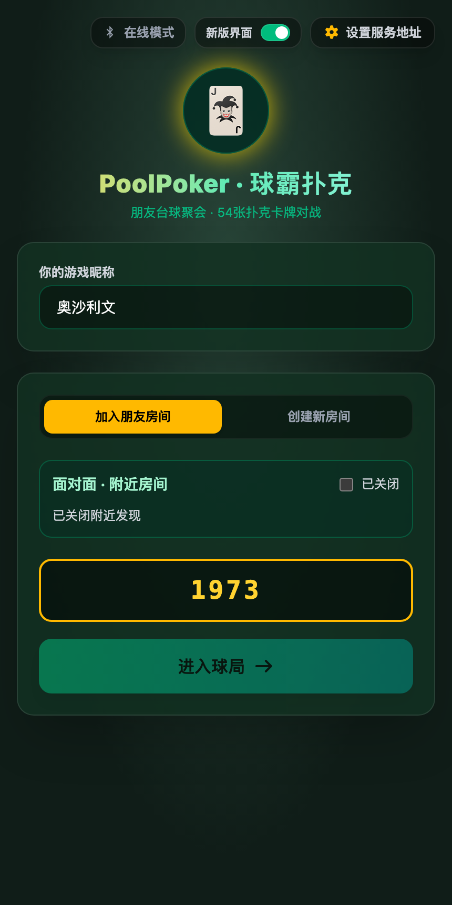
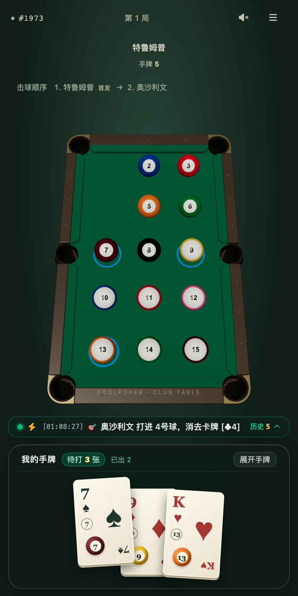
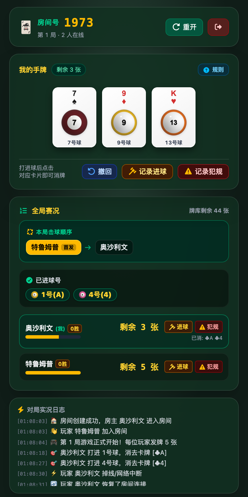

<div align="center">

<h1>
  
  <br>
  PoolPoker
</h1>

**Turn every pool shot into a high-stakes card battle.**

A full-platform real-time multiplayer card combat & scoring companion for offline pool nights — mapping 54 poker cards to pool balls 1–15 across Web, iOS, Android, Wear OS & Apple Watch, with both Online Server and Serverless Bluetooth LE modes.

Card-Ball Mapping · 3D Billiards Arena · Serverless BLE Multiplayer · Native Smartwatch Control

[Core Features](#core-features) · [Interface Preview](#interface-preview) · [Quick Start](#quick-start) · [Game Rules](#game-rules) · [Documentation](#documentation) · [License](#license)

[简体中文](README.md) | **English**

</div>

---

## Core Features

- **Complete Pool-Poker Rule Engine** — Maps a 54-card poker deck to pool balls 1–15 (`A–K` → Balls `1–13`, Small Joker → Ball `14`, Big Joker → Ball `15`, always including the 8-ball). Supports dealing, pocketing cards, auto-dimming pocketed ball numbers, foul penalty draws, break-shot pockets, accidental pockets, referee proxy actions, full-step state snapshot undo, and combo-multiplier score settlement.
- **v2 Immersive 3D Arena & v1 Classic Dual Views** — The v2 view renders a custom Blender six-pocket table in Three.js with pocket animations, projected ball hit targets, and a 3D fan hand deck; the v1 view offers a compact 2D scoreboard and live action log, switchable anytime. See [Interface Preview](#interface-preview).
- **Online Server + Serverless BLE Offline Modes** —
  - **Online Mode**: Join via a 4-digit room code or 300m geolocation nearby discovery, synced in real time over Socket.IO.
  - **Serverless BLE Face-to-Face Mode**: Connect multiple iOS/Android phones over Bluetooth Low Energy (GATT star topology) with zero internet access. The host phone runs the authoritative TypeScript engine (`LocalHostEngine`) in memory. See [BLE Offline Architecture](docs/ble_offline_architecture.md).
- **Full Cross-Platform Native Coverage** — Packaged into native Android and iOS apps via Tauri v2, paired with standalone Jetpack Compose (`:wear-app`) and SwiftUI (`poolpoker_watchOS`) smartwatch apps.
- **JSON Schema SSOT & Anti-Cheat Hand Clipping** — Draft-07 JSON Schemas automatically generate TypeScript, Kotlin, and Swift wire models. Both online and offline engines clip private unpocketed cards per `userId` and restore hands seamlessly on reconnect via `sessionToken`.

---

## Interface Preview

Switch freely between the **v2 Immersive 3D View** and the **v1 Classic 2D View** from the lobby header. Responsive across desktop browsers, mobile safe areas (Dynamic Island), and smartwatch displays.

<table>
  <tr>
    <td align="center" width="33%">
      
      <br>
      <sub><b>1. Game Lobby Entry</b><br>4-digit room code, nearby geolocation discovery, and Online / BLE Offline toggle</sub>
    </td>
    <td align="center" width="33%">
      
      <br>
      <sub><b>2. v2 Immersive 3D Arena</b><br>Three.js 3D billiards table, target ball highlights, and interactive fan hand deck</sub>
    </td>
    <td align="center" width="33%">
      
      <br>
      <sub><b>3. v1 Classic 2D Dashboard</b><br>Compact card list, player remaining counts, and live match logs</sub>
    </td>
  </tr>
</table>

---

## Quick Start

### 1. Prerequisites

Running the Web app and backend server only requires **Node.js >= 24** and **pnpm >= 12.6.0**:

```bash
# Switch to the Node.js version specified in .nvmrc (Node 24)
nvm use

# Enable pnpm via corepack if not already installed
corepack enable
```

### 2. Run Local Development (3 Steps)

From the repository root, install dependencies and start the backend Socket.IO server (`:3000`) + frontend Vite HMR server (`:5173`) concurrently:

```bash
pnpm install
pnpm run dev
```

Open **http://localhost:5173** in your browser to create or join a room (open multiple browser tabs/incognito windows to test multiplayer).

### 3. One-Step Production Build & LAN Host

To host a game on your laptop and let friends join from their phones over local Wi-Fi:

```bash
./run.sh
# Or manually:
pnpm start   # Equivalent to: pnpm run build && tsx server/index.ts (listens on http://localhost:3000)
```

The script automatically prints your LAN IP URL (e.g. `http://192.168.x.x:3000`). Server port, default cards per player (`5`), and max players (`8`) can be customized in [`config.yaml`](config.yaml).

### 4. Mobile & Smartwatch Builds (iOS / Android / Watch)

#### iOS & Apple Watch (Running in Xcode or via CLI)

The `poolpoker_iOS` target is powered by **Tauri v2 + Rust**. When you open `apple/poolpoker.xcodeproj` in Xcode and click **Run (⌘R)**, Xcode's `Build Rust Code` pre-build script automatically invokes `pnpm` and `cargo` to compile the web frontend `dist/` and `src-tauri` into the static library `libapp.a`.

Before building on a new machine, **you must configure the Rust/Tauri toolchain and your Xcode Development Team**:

1. **Install Rust and Cross-Platform Dependencies**:
   ```bash
   # Install Rust and add iOS compilation targets
   curl --proto '=https' --tlsv1.2 -sSf https://sh.rustup.rs | sh
   rustup target add aarch64-apple-ios aarch64-apple-ios-sim

   # Install frontend & Tauri CLI dependencies and generate wire models (WireModels.swift)
   nvm use
   pnpm install
   pnpm run codegen:models
   ```

2. **Configure Xcode Signing Team (`Local.xcconfig`)**:
   To avoid committing personal developer team credentials or encountering `Signing for "poolpoker_iOS" requires a development team`, copy the local configuration template (git-ignored):
   ```bash
   cp apple/Local.xcconfig.template apple/Local.xcconfig
   ```
   Open `apple/Local.xcconfig` and enter your 10-character Apple Developer Team ID:
   ```xcconfig
   DEVELOPMENT_TEAM = YOUR_TEAM_ID
   ```
   > 💡 Alternatively, you can open Xcode, select the targets (`poolpoker_iOS` / `poolpoker_watchOS`), and choose your Team under **Signing & Capabilities** (with **Automatically manage signing** checked).

Once initialized, you can either:
- **Click Run directly in Xcode**: Open `apple/poolpoker.xcodeproj`, select the `poolpoker_iOS` (or `poolpoker_watchOS`) target, and press **Run (⌘R)**.
- **Run via CLI pipelines**:
  ```bash
  pnpm exec tauri ios dev                # Live iOS Simulator development with HMR
  pnpm pipeline ios-debug --full         # Build iOS Debug package
  pnpm pipeline watchos-debug --full     # Build Apple Watch simulator package
  ```

#### Android & Wear OS

Requires **JDK 17+**, **Android SDK / NDK**, and **Rust Android targets** (`rustup target add aarch64-linux-android armv7-linux-androideabi x86_64-linux-android i686-linux-android`):

```bash
pnpm pipeline android-debug --full     # Build Android Debug APK
pnpm pipeline android-release --full   # Build Android Release APK
```

> See the [Mobile Build Pipeline Guide](docs/mobile_build_pipeline.md) for `--dry-run` inspection, signing, and concurrency lock details.

---

## Game Rules

| Card Rank | Pool Ball Number | Base Score | Notes |
|---|---|---|---|
| **A – K** (4 suits) | **Balls 1 – 13** | `2` pts / card | Every deal guarantees the **8-ball** is included |
| **Small Joker** (`JOKER-S`) | **Ball 14** | `1` pt / card | Maps to Ball 14 |
| **Big Joker** (`JOKER-B`) | **Ball 15** | `1` pt / card | Maps to Ball 15 |

1. **Pocketing & Auto-Dimming**: When a ball is pocketed on the physical table, players holding the matching rank tap the card to clear it. If a ball number is pocketed by someone else (or on the break / accidentally), matching cards in your hand automatically dim as **"Already Pocketed — No Need to Play"**.
2. **Fouls & Undo**: On a scratch or foul, tap "Record Foul" to draw a penalty card from the deck. Any mistake can be reverted with full-step snapshot **Undo**.
3. **Victory & Combo Multiplier Settlement**: **The first player to clear all active cards in their hand wins.** Losers are penalized based on remaining active cards; holding $n$ cards of the same rank multiplies their score ($\text{Score} = \text{Sum of Base Points} \times n$), and winners split the total points deducted from losers.

---

## Documentation

### Development & Build Guides

- [Contributing & Development Guide (`CONTRIBUTING_EN.md`)](CONTRIBUTING_EN.md) — Environment setup, Xcode/Android prerequisites, schema codegen, testing, and PR workflow
- [Mobile Build Pipeline (`docs/mobile_build_pipeline.md`)](docs/mobile_build_pipeline.md) — Android / iOS / watchOS task orchestration, preflight checks, and concurrency locks
- [3D Table Asset Pipeline (`docs/table_asset_pipeline.md`)](docs/table_asset_pipeline.md) — Blender source (`Git LFS`), GLB export settings, and `PocketTarget_*` anchor verification

### Architecture & Protocol Design

- [System Architecture Overview (`docs/overview.md`)](docs/overview.md) — **Authoritative deep dive**: dual-mode data flow, module responsibilities, JSON Schema SSOT, private hand clipping, and undo stack
- [BLE Offline Architecture (`docs/ble_offline_architecture.md`)](docs/ble_offline_architecture.md) — Serverless BLE star topology, `LocalHostEngine`, GATT UUIDs, compact binary protocol, and dynamic MTU chunking
- [Nearby Room Discovery (`docs/nearby_room_discovery.md`)](docs/nearby_room_discovery.md) — Geolocation-based nearby room discovery, accuracy convergence, and privacy model

### Native Mobile & Smartwatch Guides

- [Android & Tauri Architecture (`docs/android_tauri_architecture.md`)](docs/android_tauri_architecture.md) — Android Gradle multi-module setup (`:app`, `:wear-app`, `:phone-companion`, `:shared-models`) and DataLayer sync
- [Wear OS Native Architecture (`docs/wear_app_architecture.md`)](docs/wear_app_architecture.md) — Jetpack Compose for Wear OS UI modules, session recovery, and swipe-to-dismiss navigation
- [Apple Watch Native Architecture (`docs/apple_watch_architecture.md`)](docs/apple_watch_architecture.md) — watchOS 10+ SwiftUI app, Engine.IO long polling, WCSession bridge, and String Catalog localization
- [Implementation Log (`docs/implement_log.md`)](docs/implement_log.md) — Round-by-round engineering decisions and evolution history

---

## License

[Apache License 2.0](LICENSE)
