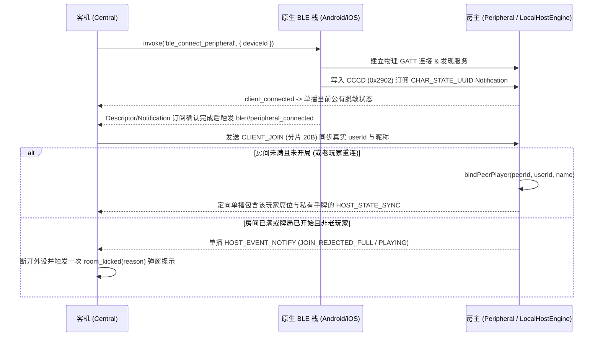

# BLE 面对面离线联机架构与协议规范 (`docs/ble_offline_architecture.md`)

本文档定义 PoolPoker（球霸扑克）**无需服务器、无需互联网连接**的蓝牙低功耗（BLE, Bluetooth Low Energy）面对面联机架构、GATT 服务拓扑、二进制传输协议规范及跨平台（Android / iOS / Web 沙盒）会话状态机。

---

## 1. 架构概览与设计原则

在无网络或信号不佳的线下台球房场景中，多部手机可通过 BLE 直接组建星型局域网（1 台房主 Peripheral + 最多 7 台客机 Central）进行完整对局。

### 1.1 核心设计原则

1. **零 C/JS 外部引擎冗余，复用纯 TypeScript 权威领域模型**
   - 房主手机直接在前端运行 `LocalHostEngine`（`src/services/localHostEngine.ts`），原汁原味复用 `server/gameEngine.ts`、`server/pokerDeck.ts` 与 `server/services/gameRoomService.ts` 的全部规则（CSPRNG 发牌、8 号球规则、胜负判定、积分结算、悔球回退）。
   - 无需 QuickJS 或独立后台 HTTP Server。
2. **虚拟 Socket 适配器模式（`BleTransport`）**
   - `BleTransport`（`src/services/bleTransport.ts`）模拟 `socket.io-client` 的 `.on()` / `.emit()` / `.connect()` / `.disconnect()` 接口。
   - 上层业务状态层（`useGameRoom.ts`、`useNearbyRooms.ts`）与 UI 组件无需感知底层是 WebSocket 还是 BLE GATT，仅通过 `useSocket.ts` 的 `toggleBleOfflineMode()` 即可无感切换。
3. **房主零拷贝直通，客机紧凑二进制定向单播**
   - **房主本人**：通过 `LocalHostEngine.getDirectClientRoom(hostUserId)` 直接获取无损脱敏 `Room` 视图（完整保留 15 条对局日志、真实卡牌 ID `c_1..c_54` 与玩家昵称），不经过二进制编解码自环。
   - **蓝牙客机**：房主为每位已连接的客机单独生成脱敏二进制状态帧（仅包含该客机自己的手牌索引，绝不泄露其他玩家未打出的底牌），并通过 GATT Notification 按 `peerId` 定向单播。

### 1.2 分层数据流拓扑

```
┌─────────────────────────────────────────────────────────────────────────┐
│ Vue 3 视图与业务层 (RoomLobby.vue / useGameRoom.ts / useNearbyRooms.ts) │
└───────────────────┬─────────────────────────────────┬───────────────────┘
                    │ emit / on                       │ startContinuousScan
                    ▼                                 ▼
┌───────────────────────────────────────┐ ┌───────────────────────────────┐
│ BleTransport (src/services/...)       │ │ BleScanner (12s TTL 过期淘汰)  │
│  ├─ 房主模式: LocalHostEngine (权威)   │ └───────────────┬───────────────┘
│  └─ 客机模式: BleChunkReassembler      │                 │
└───────────────────┬───────────────────┘                 │
                    │ invoke / listen ('ble://*')         │
                    ▼                                     ▼
┌─────────────────────────────────────────────────────────────────────────┐
│ Rust Tauri 桥接层 (src-tauri/src/ble_mesh.rs)                            │
│  ├─ Android: JNI 双向桥接 (Java_com_poolpoker_app_BleMeshManager_*)     │
│  └─ iOS:     Swift C-ABI 双向桥接 (@_cdecl / @_silgen_name)             │
└───────────────────┬─────────────────────────────────┬───────────────────┘
                    │                                 │
                    ▼                                 ▼
┌───────────────────────────────────────┐ ┌───────────────────────────────┐
│ Android 原生 BLE 栈                    │ │ iOS 原生 CoreBluetooth 栈      │
│ (BleMeshManager.kt)                   │ │ (BleMeshBridge.swift)         │
│  ├─ BluetoothLeAdvertiser / GattServer│ │  ├─ CBPeripheralManager       │
│  └─ BluetoothLeScanner / BluetoothGatt│ │  └─ CBCentralManager          │
└───────────────────────────────────────┘ └───────────────────────────────┘
```

---

## 2. GATT 服务与广播规范

### 2.1 GATT UUID 定义

| 角色 / 用途 | 名称 | 128-bit UUID | 属性与权限 |
| :--- | :--- | :--- | :--- |
| 主服务 | `SERVICE_UUID` | `0000a848-0000-1000-8000-00805f9b34fb` | Primary Service |
| 上行指令特征值 (客机 → 房主) | `CHAR_COMMAND_UUID` | `0000a849-0000-1000-8000-00805f9b34fb` | `Write`, `WriteWithoutResponse` |
| 下行状态特征值 (房主 → 客机) | `CHAR_STATE_UUID` | `0000a84a-0000-1000-8000-00805f9b34fb` | `Notify`, `Read` (含 CCCD `0x2902`) |

### 2.2 跨平台广播载荷与解析兼容

受限于传统 BLE 广播包（Legacy Advertising PDU）31 字节上限及 iOS `CBPeripheralManager` 仅允许广播 `ServiceUUIDs` 与 `LocalName` 的系统限制，双端采用互补编码并在扫描端双向兼容解析：

- **Android 房主广播（`BleMeshManager.kt`）**：
  - 主广播包（Advertising Data）：包含 128-bit `SERVICE_UUID`。
  - 扫描响应包（Scan Response）：携带 `ServiceData(SERVICE_UUID)`，内容为 UTF-8 字符串 `"<roomCode>|<shortHostName>"`（其中 `shortHostName` 经 `truncateUtf8` 截断至最多 8 字节，确保不越界）。
- **iOS 房主广播（`BleMeshBridge.swift`）**：
  - 广播 `CBAdvertisementDataServiceUUIDsKey: [POOLPOKER_SERVICE_UUID]`。
  - 广播 `CBAdvertisementDataLocalNameKey: "PoolPoker_<roomCode>_<shortHostName>"`（`shortHostName` 最多 8 字节 UTF-8）。
- **扫描端统一解码与过期淘汰**：
  - Android `ScanCallback` 与 iOS `didDiscover` 均优先解析 `ServiceData`（按 `|` 分割房间号与房主昵称），若无则回退解析 `LocalName`（识别 `PoolPoker_` 前缀并按 `_` 分割）。
  - iOS 开启 `CBCentralManagerScanOptionAllowDuplicatesKey: true` 并按外设 UUID 执行 1.5s 节流上报，确保距离/信号强度（RSSI）实时刷新，同时配合前端 `BleScanner` 的 **12 秒 TTL 过期清理定时器**自动剔除已关闭的房间。

---

## 3. 二进制协议规范 (`shared/types/bleProtocol.ts`)

协议版本号：`BLE_PROTOCOL_VERSION = 0x01`。所有多字节整数采用大端序（Big-Endian）。

### 3.1 卡牌与台球编码映射

- **扑克牌索引（`0..53`，1 Byte）**：
  - `0..51`：`index = suitIndex * 13 + (ballNumber - 1)`，花色顺序：`0: ♠ (spade)`, `1: ♥ (heart)`, `2: ♣ (club)`, `3: ♦ (diamond)`；点数 `1..13` 对应 `A..K`。
  - `52`：小王（`JOKER-S`，对应 14 号球，`color: 'gray'`）。
  - `53`：大王（`JOKER-B`，对应 15 号球，`suit: '👑'`, `color: 'gold'`）。
  - 默认解码生成的卡牌 ID 为 `c_1..c_54`，与服务端 `create54PokerDeck()` 完全对齐。
- **台球落袋位掩码（`pocketedBallsMask`，2 Bytes `uint16`）**：
  - Bit `1..15` 分别对应 1~15 号球是否已落袋（`mask & (1 << ballNumber)`）。

### 3.2 消息类型（`BleMessageType`）

| 枚举名 | 十六进制值 | 方向 | 说明 |
| :--- | :--- | :--- | :--- |
| `HOST_STATE_SYNC` | `0x10` | 房主 → 客机 | 完整单帧房间状态同步 |
| `CLIENT_COMMAND` | `0x11` | 客机 → 房主 | 客机游戏操作指令（8 字节定长） |
| `HOST_STATE_CHUNK` | `0x12` | 房主 → 客机 | 下行状态分片包（超 MTU 时自动切片） |
| `CLIENT_JOIN` | `0x13` | 客机 → 房主 | 客机入房/重连身份握手帧（携带真实 `userId` 与昵称） |
| `HOST_EVENT_NOTIFY` | `0x14` | 房主 → 客机 | 房主控制事件帧（踢人、满员/开局拒连、退房确认 `LEAVE_ACK`） |
| `CLIENT_COMMAND_CHUNK` | `0x15` | 客机 → 房主 | 上行指令/握手分片包（兼容最小 ATT MTU 23） |

### 3.3 帧结构定义

#### (1) 下行房间状态帧 (`HOST_STATE_SYNC = 0x10`)

- **定长头部（11 Bytes）**：
  - `Byte 0`: `version` (`0x01`)
  - `Byte 1`: `msgType` (`0x10`)
  - `Byte 2..3`: `revision` (`uint16`)
  - `Byte 4`: `status & cardsPerPlayer`（高 4 位：`0=WAITING, 1=PLAYING, 2=FINISHED`；低 4 位：`cardsPerPlayer`）
  - `Byte 5..6`: `pocketedBallsMask` (`uint16`)
  - `Byte 7`: `roundCount` (`uint8`)
  - `Byte 8`: `deckRemaining` (`uint8`)
  - `Byte 9`: `selfAndHostIndex`（高 4 位 `hostSeatIndex`，低 4 位 `selfSeatIndex`，未分配为 `0x0F`）
  - `Byte 10`: `selfHandCount` (`uint8`)
- **接收方私有手牌区（`selfHandCount` Bytes）**：每个字节为一个卡牌索引 `0..53`。
- **玩家席位列表**：
  - `Byte P0`: `playerCount` (`0..8`)
  - 每个玩家席位基础记录（7 Bytes）：
    - `userIdHash` (`uint32`, FNV-1a 32-bit 哈希)
    - `flagsAndCards` (`uint8`：Bit7 `isHost`, Bit6 `online`, Bit5 `isWinner`, 低 5 位 `cardCount`)
    - `totalScore` (`int16` 补码)
- **尾部扩展区（Magic `0xA5`）**：
  - `extFlags` (`uint8`)：
    - `Bit 0 (0x01)`: 包含 `turnOrderSeats`（`1B length + N Bytes seatIndex`）
    - `Bit 1 (0x02)`: 包含 `sceneEvent`（`1B kind + 1B ballNumber + 2Brevision`）
    - `Bit 2 (0x04)`: 包含 `lastActionText`（`1B byteLen + UTF-8 bytes`，编码前强制通过 `truncateUtf8Bytes` 限制在 **180 字节**以内，严防 `uint8` 长度溢出）
    - `Bit 3 (0x08)`: 包含每位玩家的扩展详情（`1B nameLen + UTF-8 name [上限 48 字节] + 1B wins + 1B pocketedCount + pocketedIndices + 1B revealedCount + revealedIndices`）

#### (2) 上行客机指令帧 (`CLIENT_COMMAND = 0x11`，定长 8 Bytes)

- `Byte 0`: `version` (`0x01`)
- `Byte 1`: `msgType` (`0x11`)
- `Byte 2`: `revision` (`uint8`)
- `Byte 3`: `actionType` (`1=START_GAME, 2=POCKET_BALL, 3=DRAW_PENALTY, 4=ACCIDENTAL_POCKET, 5=BREAK_POCKET, 6=RETRACT_BALL, 7=RESTART_GAME, 8=REFEREE_POCKET, 9=REFEREE_PENALTY, 10=UPDATE_SETTINGS, 11=KICK_PLAYER, 12=LEAVE_ROOM`)
- `Byte 4`: `ballNumber` (`uint8`)
- `Byte 5`: `cardIndex` (`uint8`, 无则为 `0xFF`)
- `Byte 6`: `cardsPerPlayer` (`uint8`)
- `Byte 7`: `targetSeatIndex` (`uint8`, 无则为 `0xFF`)

#### (3) 上行入房握手帧 (`CLIENT_JOIN = 0x13`)

- `[0x01, 0x13, revision(2B), roomCode(2B), userIdLen(1B), ...userIdBytes, nameLen(1B), ...nameBytes]`

#### (4) 下行控制事件帧 (`HOST_EVENT_NOTIFY = 0x14`，定长 5 Bytes)

- `[0x01, 0x14, code(1B), roomCodeHigh(1B), roomCodeLow(1B)]`
- `code`: `1 = KICKED`, `2 = JOIN_REJECTED_FULL`, `3 = JOIN_REJECTED_PLAYING`, `4 = LEAVE_ACK`。

#### (5) 分片与重组帧 (`HOST_STATE_CHUNK = 0x12` / `CLIENT_COMMAND_CHUNK = 0x15`)

- **5 字节分片头**：`[0x01, chunkMsgType(1B), transferId(1B), chunkIndex(1B), totalChunks(1B), ...sliceBytes]`
- **动态 MTU 适配**：
  - 下行方向：Android 根据每个 `BluetoothDevice` 协商的 `clientMtuMap`（默认回退 23 字节即 20 字节载荷），iOS 根据 `CBCentral.maximumUpdateValueLength` 动态计算单包切片上限。
  - 上行方向：`CLIENT_JOIN` 握手默认按 20 字节安全上限切分为 `CLIENT_COMMAND_CHUNK`，兼容尚未完成大 MTU 协商的初期连接。
  - 重组器 `BleChunkReassembler` 按 `transferId` 校验分片连续性，收到新 `transferId` 时自动丢弃旧批次残片。

---

## 4. 连接、握手、重连与退房状态机



### 关键时序不变量

1. **先完成订阅，再触发 `peripheral_connected` 发送握手**：
   - Android 必须在 `BluetoothGattCallback.onDescriptorWrite`（CCCD 写入完成）之后、iOS 必须在 `peripheral(_:didUpdateNotificationStateFor:error:)`（Notification 订阅生效）之后，才向前端发射 `ble://peripheral_connected` 并开启上行发送队列。
   - 这杜绝了“客机刚连上立即发出 `CLIENT_JOIN`，房主回复状态通知或拒连帧时客机尚未完成 CCCD 订阅导致首包丢失”的竞态。
2. **上行无响应写入（`writeWithoutResponse`）流控**：
   - Android 通过 `isClientWriteInFlight` + `onCharacteristicWrite` 串行化写入队列。
   - iOS 通过 `CBPeripheral.canSendWriteWithoutResponse` 与 `peripheralIsReady(toSendWriteWithoutResponse:)` 回调控制出队，防止长昵称多片 `CLIENT_JOIN` 报文被 CoreBluetooth 静默丢弃。
3. **满员房间老玩家 MAC 轮换重连保护**：
   - 当客机因系统蓝牙隐私策略轮换物理地址（`peerId`）重连时，房主在 `ble://client_connected` 阶段**绝不**按临时 `peerId` 提前拒连，而是等待 `CLIENT_JOIN` 报文揭晓真实 `userId` 后，在 `bindPeerPlayer` 中匹配既有席位并无损恢复在线状态与手牌。
4. **主动退房 `LEAVE_ACK` 确认握手机制**：
   - 客机点击退出房间时，先发送 `LEAVE_ROOM` 指令并等待房主返回 `HOST_EVENT_NOTIFY(LEAVE_ACK)`（1.5 秒超时兜底），确认房主已释放席位后再调用 `ble_disconnect_peripheral` 断开物理连接。

---

## 5. 平台权限与配置要求

- **Android (`android/app/src/main/AndroidManifest.xml`)**：
  - Android 12+ (API 31+)：`BLUETOOTH_SCAN`（`neverForLocation`）、`BLUETOOTH_ADVERTISE`、`BLUETOOTH_CONNECT`。
  - Android 11 及以下：`BLUETOOTH`、`BLUETOOTH_ADMIN`、`ACCESS_FINE_LOCATION`。
- **iOS (`apple/poolpoker_iOS/Info.plist`)**：
  - `NSBluetoothAlwaysUsageDescription`：声明使用蓝牙在附近建立面对面台球扑克房间。
- **模式切换隔离 (`src/composables/useSocket.ts` & `useGameRoom.ts`)**：
  - 切换在线/离线模式（`toggleBleOfflineMode`）时自动清理 `billiards_room_code`、`billiards_session_token` 与 `poolpoker_ble_device_id`，并在离线模式下跳过远端 HTTP `/api/rooms/:code` 快照拉取与手表在线凭证同步。
