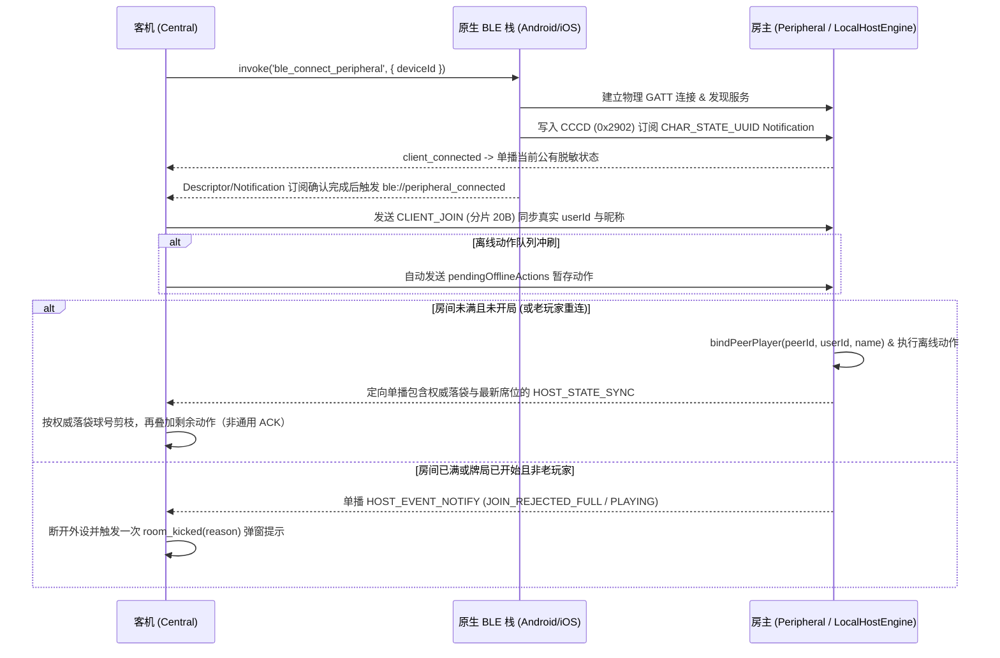

# BLE 面对面离线联机架构与协议规范 (`docs/ble_offline_architecture.md`)

本文档定义 PoolPoker（球霸扑克）**无需服务器、无需互联网连接**的蓝牙低功耗（BLE, Bluetooth Low Energy）面对面联机架构、房主权威与客机乐观更新链路、传输层模块化分工、统一传输接口、GATT 服务拓扑、二进制传输协议规范以及作为技术储备的 CRDT 确定性事件溯源模型。

---

## 1. 架构概览与设计原则

在无网络或信号不佳的线下台球房场景中，多部手机可通过 BLE 直接组建局域对局网络（1 台房主 Peripheral + 最多 7 台客机 Central）进行完整对局。

### 1.1 现实痛点与架构演进

线下打台球存在极其普遍的使用习惯：
- **交替锁屏与离线记牌**：房主建房开局后，看完自己的手牌通常会**立即锁屏将手机放入口袋**；随后其他成员轮流上台击球，某位成员亮屏记录进球/罚牌，记录完毕后也**随手锁屏入兜**。
- **传统 GATT 单主星型网络的痛点**：
  - 房主 Peripheral 锁屏后，系统可能暂停页面执行或断开 GATT 链路；要求每次操作等待房主确认会阻塞记牌；
  - 若直接用某一端的临时快照覆盖其他设备，可能丢失尚未汇合的离线动作，因此需要区分本地记录、乐观视图与房主权威状态。
- **当前生产架构：房主权威状态 ＋ 客机乐观更新 ＋ 待发送队列**：
  - **房主权威单主**：房主端运行 `LocalHostEngine`，洗牌、实际发牌与最终对局状态由房主决定；
  - **客机乐观更新**：客机在断线或房主锁屏时先更新本地视图并播放动画。文中“0ms”指无需等待网络往返，不是实测零延迟，也不代表权威提交完成；
  - **离线队列持久化与自动冲刷**：动作推入待发队列，恢复连接后串行重放。当前主要依据权威落袋球号剪枝，尚无通用动作确认与持久化去重，不能据此宣称所有动作均无冲突收敛。
- **未来去中心化储备：CRDT 纯领域事件溯源**：
  - 在 `src/services/crdt/` 中保留了完整的无主确定性事件演算模型，供后续向完全无主 Mesh 拓扑演进。

### 1.2 核心设计原则

1. **零 C/JS 外部引擎冗余，复用纯 TypeScript 权威领域模型**
   - 房主手机直接在前端运行 `LocalHostEngine`（`src/services/localHostEngine.ts`），复用 `server/gameEngine.ts`、`server/pokerDeck.ts` 与 `server/gameRoomService.ts` 的规则（CSPRNG 发牌、8 号球规则、胜负判定、积分结算、悔球回退），并增加本地存储恢复支持。
   - 无需 QuickJS 或独立后台 HTTP Server。
2. **统一传输接口与传输层模块化分工（`GameTransport` & `src/services/ble/`）**
   - 定义项目统一的 `GameTransport` 传输接口（`src/types/transport.ts`），彻底替换此前将 BLE 强制转为 Socket 的类型断言（`ble as any as Socket`）。
   - 将原单文件膨胀的传输层拆分为 5 大高内聚低耦合模块：
     - `BleConnectionManager`：连接生命周期、Tauri 原生事件监听与断线自动重连；
     - `BleHandshakeManager`：入房握手分包、`peerId ↔ userId` 映射与退房 `LEAVE_ACK` 协商；
     - `BleCommandQueue`：离线待发动作队列、记球类动作重试与权威落袋球剪枝；
     - `BleStateSync`：下行状态重组、客机 0ms 乐观更新演算与房主状态脱敏单播；
     - `BleStorage`：设备 ID、房间快照与动作队列持久化（`localStorage` + 内存降级）。
3. **客机本地乐观更新与离线队列双重持久化**
   - 客机即使处于蓝牙断开状态，打出卡牌或记球仍立即在本地生效（消除手牌、增加落袋球、触发 3D 动画与音效）；
   - 离线动作写入 `localStorage` 并保留内存副本，以支持页面重载恢复；存储不可用时退化为内存缓存，无法保证跨进程恢复。重连后冲刷并叠加仍待处理的动作。
4. **房主零拷贝直通，客机紧凑二进制定向单播**
   - **房主本人**：通过 `LocalHostEngine.getDirectClientRoom(hostUserId)` 直接获取无损脱敏 `Room` 视图（完整保留 15 条对局日志、真实卡牌 ID `c_1..c_54` 与玩家昵称），不经过二进制编解码自环。
   - **蓝牙客机**：房主为每位已连接的客机单独生成脱敏二进制状态帧（仅包含该客机自己的手牌索引，绝不泄露其他玩家未打出的底牌），并通过 GATT Notification 按 `peerId` 定向单播。

### 1.3 分层数据流拓扑

```
┌─────────────────────────────────────────────────────────────────────────┐
│ Vue 3 视图与业务层 (RoomLobby.vue / useGameRoom.ts / useNearbyRooms.ts) │
│ • Screen WakeLock 屏幕常亮保护   • 离线动作放行   • 0ms 乐观响应          │
└───────────────────┬─────────────────────────────────┬───────────────────┘
                    │ emit / on (统一 GameTransport)    │ startContinuousScan
                    ▼                                 ▼
┌───────────────────────────────────────────────────┐ ┌───────────────────┐
│ BleTransport (src/services/bleTransport.ts 门面协调)│ │ BleScanner        │
│  ├─ 连接管理: BleConnectionManager                │ └─────────┬─────────┘
│  ├─ 握手鉴权: BleHandshakeManager                 │           │
│  ├─ 指令队列: BleCommandQueue                     │           │
│  ├─ 状态同步: BleStateSync                        │           │
│  ├─ 存储持久化: BleStorage                         │           │
│  └─ 房主权威引擎: LocalHostEngine (运行于房主端)     │           │
└───────────────────┬───────────────────────────────┘           │
                    │ invoke / listen ('ble://*')               │
                    ▼                                           ▼
┌─────────────────────────────────────────────────────────────────────────┐
│ Rust Tauri 桥接层 (src-tauri/src/ble_mesh.rs)                            │
│  ├─ Android: JNI 双向桥接 (Java_com_poolpoker_app_BleMeshManager_*)     │
│  └─ iOS:     Swift C-ABI 双向桥接 (@_cdecl / @_silgen_name)             │
└───────────────────┬─────────────────────────────────┬───────────────────┘
                    │                                 │
                    ▼                                 ▼
┌───────────────────────────────────────┐ ┌───────────────────────────────┐
│ Android 原生 BLE 栈                    │ │ iOS 原生 CoreBluetooth 栈      │
│ (BleMeshManager.kt)                   │ │ (BleMeshBridge.swift)         │
│  ├─ BluetoothLeAdvertiser / GattServer│ │  ├─ CBPeripheralManager       │
│  └─ BluetoothLeScanner / BluetoothGatt│ │  └─ CBCentralManager          │
└───────────────────────────────────────┘ └───────────────────────────────┘
```

### 1.4 一致性模型与实现状态

用 $S_H^h$ 表示房主第 $h$ 次权威状态变更后的状态，$\pi_i$ 表示面向玩家 $i$ 的私有手牌裁剪，$Q_i$ 表示其待发动作序列。当前链路可抽象为：

$$
S_H^{h+1}=F(S_H^h,a_h;\rho_h),\qquad
V_i=\operatorname{Overlay}(\pi_i(S_H^h),Q_i)
$$

其中 $\rho_h$ 表示该步需要时由房主产生的随机输入（例如新牌库洗牌）。$V_i$ 是客机的临时视图，可能包含未被房主接受的动作；各设备收到的快照版本也可能不同。$h$ 是模型中的逻辑版本，不等同于当前线上帧中会回绕的有限位宽 `revision`。

| 能力 | 实现状态与代码依据 | 保证边界 |
| :--- | :--- | :--- |
| 房主裁决、客机乐观展示 | **已接入**：`LocalHostEngine`、`BleTransport`、`BleStateSync` | 本地显示成功不等于房主执行成功；房主不可达时不能确认新抽到的真实卡牌 |
| 离线动作恢复、记球重试 | **已接入**：`BleStorage`、`BleCommandQueue` | 依赖存储成功、链路恢复和房主继续处理；落袋球号剪枝不是通用动作 ACK |
| BLE 犯规只能自记 | **已接入前端**：`useGameRoom`、`RefereeFoulModal.lockedUserId` | 约束记牌责任；`LocalHostEngine.executeAction` 仍支持给其他成员罚牌，不是协议层权限不变量 |
| 事件集合合并与确定性重放 | **技术储备**：`src/services/crdt/` 与独立单测 | 当前未接入 BLE 主链路，不能据此认定生产链路具备强最终一致性 |
| 动作 ID、持久化去重、同版本确认 | **待实现**：第 3.6 节 | 目标是消除重复罚牌及已执行动作再次叠加 |
| 预分配离线抽牌权 | **可选演进，未实现**：第 3.7 节 | 允许额度内离线拿到确定卡牌，需要改变共享牌堆的分配规则 |

以下公式是针对 PoolPoker 的模型化分析，需同时满足标注的前提；现有单元测试是具体用例验证，不是对所有执行路径的形式化证明。

---

## 2. 【技术储备】CRDT 确定性事件溯源与无冲突收敛模型 (`src/services/crdt/`)

> [!NOTE] 架构现状与实现对齐
> 本节描述的事件集合存储与确定性演算器已在纯领域层实现，并有独立单元测试（`crdtEngine.spec.ts`）；事件传播、因果时钟维护、身份校验与提交协议仍需集成。
> 当前生产运行链路采用**「房主权威状态（LocalHostEngine）＋客机乐观更新（applyLocalOptimisticAction）＋待发送离线队列（BleCommandQueue）」**（详见第 3 节）。

### 2.1 创世基线（Genesis Snapshot）与确定性 Mulberry32 PRNG

储备模型通过 `createGenesisSnapshot` 生成不可变的开局基线。未来接入时，需要在开局阶段完成基线分发与席位确认；当前 BLE `start_game` 不会分发该对象：

```typescript
export interface GenesisSnapshot {
  gameId: string;              // 全局唯一对局 UUID
  roomCode: string;            // 4 位房间码
  startedAt: number;           // 开局时间戳
  deckSeed: number;            // 数值种子；当前由加密随机源生成
  settings: {
    cardsPerPlayer: number;    // 每人发牌数
    includeBlackEight: boolean;
  };
  players: Array<{
    userId: string;
    name: string;
    seatIndex: number;
  }>;
}
```

- **确定性 Mulberry32 伪随机数发生器**：给定相同的 32 位种子 `deckSeed`，在任何设备（V8、JavaScriptCore、QuickJS）上均产生完全一致的伪随机序列，驱动 Fisher-Yates 算法洗牌，使所有设备即使在完全离线状态下也能确定性推导出初始牌堆分配。
- **私密性边界**：Mulberry32 本身不是 CSPRNG。共享 `deckSeed` 与席位后，各设备可推导所有初始手牌及后续牌序；仅裁剪返回视图不能阻止推导。该模型适用于确定性演算验证，接入生产前需另外设计私有发牌协议，保留生产路径的 CSPRNG 约束。

### 2.2 离线操作事件规范（Game Events）与 Lamport 全序时钟

离线操作抽象为不可变的离线操作事件流：

```typescript
export type GameEventType =
  | 'POCKET_BALL'        // 正常进球 (消除对应手牌)
  | 'DRAW_PENALTY'       // 抽罚牌 (从确定性牌堆抓取下一张)
  | 'ACCIDENTAL_POCKET'  // 误进事故球
  | 'BREAK_POCKET'       // 开球进球
  | 'RETRACT_EVENT';     // 悔球 (撤销特定前置 eventId)

export interface GameEvent {
  eventId: string;        // 当前格式：actorUserId_lamportTime_randomSuffix
  gameId: string;
  actorUserId: string;
  type: GameEventType;
  lamportTime: number;    // 逻辑时钟，用于偏序排定
  wallTime: number;       // 物理毫秒时间戳
  ballNumber?: number;    // 目标球号 (1..15)
  targetUserId?: string;  // 裁判代记目标
  retractTargetId?: string; // 悔球对应的被撤销事件 ID
}
```

- **全序比较器 (`compareGameEvents`)**：实际排序规则为 `lamportTime 升序 -> actorUserId 字典序 -> eventId 字典序`；`wallTime` 用于日志展示，不参与排序。
- **Lamport 模型**：因果关系满足 $e\to f\Rightarrow L(e)<L(f)$；本地事件递增时钟，收到远端时钟 $L_r$ 时更新 $L_i\leftarrow\max(L_i,L_r)+1$。再按 $(L,\mathrm{actorId},\mathrm{eventId})$ 字典序扩展为确定全序。它不保证并发事件的真实物理先后，也不代表所有事件已收齐。[R2][ref-lamport]
- **实现前提**：`createGameEvent` 仅使用调用方提供的 `currentMaxLamport + 1`，接入方必须维护上述因果时钟。当前 `eventId` 使用有限随机后缀，数学分析假设事件 ID 唯一、不可变且同一 ID 对应同一载荷；生产化需可靠的 ID 生成与载荷冲突检测，重传必须复用原 ID。

### 2.3 确定性状态演算函数 (`reduceGameState`)

`reduceGameState(genesis, events, viewUserId?)` 是一个**无副作用的纯函数**：
1. **幂等去重**：以 `eventId` 为键过滤重复到达的事件包；
2. **处理撤销**：扫描所有 `RETRACT_EVENT` 并建立剔除黑名单；
3. **确定性重放**：按照全序重放有效事件流，更新已落袋球号、玩家手牌与剩余牌堆；
4. **胜负判定与脱敏裁剪**：根据当前落袋球号判定玩家是否清空有效手牌，并根据 `viewUserId` 裁剪非本人私有底牌。

设 $G$ 为相同开局基线，$E$ 为同一局内按 ID 去重的不可变事件集合，$R(E)$ 为撤销事件指定的目标 ID 集合，则该演算器可表示为：

$$
\operatorname{State}(G,E)=\operatorname{Fold}\!\left(
G,\operatorname{Sort}_{(L,\mathrm{actorId},\mathrm{eventId})}
\{e\in E\mid e.\mathrm{type}\ne\mathrm{RETRACT\_EVENT}\land e.\mathrm{eventId}\notin R(E)\}
\right)
$$

事件日志按集合并集合并。在 ID/载荷一致、基线相同、演算规则相同、事件最终送达的前提下，$E_A=E_B$ 蕴含 $\operatorname{State}(G,E_A)=\operatorname{State}(G,E_B)$。这里事件集合的合并满足半格条件；抽牌等操作本身仍可依赖顺序。该区分对应 CRDT 的强收敛条件，而不是“所有业务操作都可交换”。[R1][ref-crdt]

**边界**：后到事件可能插入既有排序之前，改变先前的抽牌结果；追加撤销事件也可能改变历史状态。因此，最终计算一致不意味着中间结果不可撤销，更不等于已实现共识或最终提交。当前去重遇到同 ID 不同载荷时保留先见版本，不满足上述载荷一致前提；撤销策略也只过滤其直接目标，不提供通用的“撤销一次撤销”。

### 2.4 落袋球号的单调集合模型

PoolPoker 判定胜负的核心是“未打出的有效卡牌数量为 0”，而有效卡牌由全局已落袋球号列表 `pocketedBallNumbers` 决定：

$$
B = B_{\text{accidental}} \cup B_{\text{break}} \cup \bigcup_{p \in \text{players}} \{\operatorname{ball}(c)\mid c\in p.\mathrm{pocketedCards}\}
$$

限定在同一局、只新增球号且没有撤销的子模型中，状态空间为 $(\mathcal P(\{1,\ldots,15\}),\subseteq)$，合并为集合并集，更新为 $B\leftarrow B\cup\{b\}$。它满足：

$$
A\cup B=B\cup A,\qquad
(A\cup B)\cup C=A\cup(B\cup C),\qquad
A\cup A=A
$$

这正是增长集合（G-Set）的合并模型：成员 A 记录 3 号球、成员 B 记录 8 号球，在有效更新最终送达后可得到同一集合 $\{3,8\}$。[R1][ref-crdt] 当前 BLE 链路采用房主快照与动作重放，没有直接部署全量 G-Set 副本协议。

对玩家手牌 $H_p$，有效牌集合为 $A_p=\{c\in H_p\mid\operatorname{ball}(c)\notin B\}$，清空条件为 $|A_p|=0$。**在 $H_p$ 固定、$B$ 只增的子模型中**，有效牌数量单调不增；罚牌会增加 $H_p$，撤销会减少 $B$，重开会更换基线。这些操作及终局后的动作接收规则均不在上述 G-Set 证明范围内。

### 2.5 犯规抽牌的非交换性与自记规则

设共享牌堆从顶到底为 $D=(x,y,\ldots)$，$T_A,T_B$ 分别表示向玩家 A、B 发一张罚牌。先 A 后 B 得到 $(H_A\cup\{x\},H_B\cup\{y\})$；先 B 后 A 得到 $(H_A\cup\{y\},H_B\cup\{x\})$，一般有：

$$T_B(T_A(S))\ne T_A(T_B(S))$$

该反例适用于两人都只给自己记犯规的情形，说明自记规则不能使共享抽牌操作可交换。**当前生产路径也没有让客机复制牌堆自行抽牌**：`BleStateSync.applyLocalOptimisticAction` 只增加目标 `cardCount`，真实卡牌由房主的 `server/gameRoomService.ts:drawPenaltyCard` 发放。

**前端规则**：BLE 模式下 `useGameRoom` 将犯规目标限制为本人，`RefereeFoulModal` 通过 `lockedUserId` 锁定目标，v1 隐藏其他玩家的犯规入口。这用于明确记牌责任、减少多人重复记录同一次现实犯规；它不提供传输去重，也未在 BLE 引擎入口强制执行。

### 2.6 不变量合流性与必须协调的边界

I-confluence 以业务不变量 $I$、允许的事务和合并函数为前提，判断合法分支是否总能合并成合法状态。[R3][ref-iconfluence] 对来自同一合法祖先、各自经过合法事务到达的状态 $s_a,s_b$，需要检查：

$$I(s_a)\land I(s_b)\Rightarrow I(s_a\sqcup s_b)$$

这是在指定可达状态与合并规则下的闭包要求，不能仅凭“使用 CRDT”推导所有业务约束都成立。应用到本项目，共享牌库每一张**牌实例**最多分配一次；牌实例应包含牌库批次，以区分牌库耗尽后补充的新一副牌。当前生产引擎会在空牌堆时重新洗入 54 张牌。

反例：某批次只剩一张牌 $x$，两端完全断联且都没有预留抽牌权，分别向不同玩家永久分配 $x$。两个分支单独合法，直接合并分配记录却违反唯一分配约束。在保持共享牌堆语义时，不能同时要求两端都立即成功、牌面永久不变且不重复分配；需要等待权威分配、允许重算，或事先分配互斥资源权利。此处是针对 PoolPoker 操作语义的推导，不是论文对本项目的形式化验证。

---

## 3. 客户端本地乐观更新与离线队列同步机制

### 3.1 本地乐观执行（`applyLocalOptimisticAction`）

客机用户点击手牌或点击 3D 台面球号时，`BleTransport.emit` 不再受 `this.connected` 限制：
- **无需等待网络往返的临时更新**：
  1. 从自身手牌中移除对应卡牌并移入 `pocketedCards`；
  2. 将球号追加到 `cachedRoom.pocketedBallNumbers` 并排序；
  3. 按本地可见手牌计算临时胜负，可能将本地 `status` 置为 `finished`；客机缺少他人完整手牌和未汇合动作，该结果不是全局终局证明；
  4. 构造 `sceneEvent` 驱动 Three.js 台球滚入球袋动画与落袋音效；
  5. 强制触发 `room_updated`，页面 UI 即刻响应，消除网络等待感。

罚牌仅乐观增加 `cardCount`，不会生成可使用的新卡牌；撤销、设置与重开等命令也不能从记球的集合模型推导出相同的乐观更新保证。

### 3.2 离线动作双重持久化队列（`pendingOfflineActions`）

- 客机产生的每一个本地动作，立即加入 `pendingOfflineActions` 数组；
- 存储策略：写入 JS 内存副本与 `localStorage`（键名格式 `poolpoker_ble_{roomCode}_pending_actions`）；内存副本用于当前进程降级，不是第二份耐久存储；
- 当 `localStorage` 写入成功且数据未被清除时可用于重载恢复；写入异常、存储被系统清除或设备永久故障时没有绝对不丢失保证。当前快照与队列分别写入，也没有跨键事务提交保证。

### 3.3 物理链路恢复自动冲刷（`flushPendingOfflineActions`）

当房主手机点亮屏幕或走入连接范围，底层触发 `ble://peripheral_connected` 原生事件：
1. 客机自动调用 `sendJoinHandshake()` 恢复身份席位；
2. 自动触发 `flushPendingOfflineActions()`，从持久化存储提取未确认动作，按 60ms 间隔串行向房主写入特征值；
3. 房主端本地权威引擎 `executeBinaryAction` 执行动作并向全场广播权威状态；
4. 客机在接收到权威状态（`HOST_STATE_SYNC`）后，`prunePocketedBalls` 按权威落袋球号过滤带有相同球号的待发动作，并将其余动作重新叠加到快照上。此处推断的是球号效果已出现，不证明指定动作已被房主执行。

**当前限制**：`retryOnly` 定时重试只覆盖 `POCKET_BALL`、`REFEREE_POCKET`、`ACCIDENTAL_POCKET`、`BREAK_POCKET`；连接恢复时的完整冲刷则包含其他待发动作。罚牌没有球号，不能被上述剪枝确认，可能在房主已经发牌后仍被叠加，或在再次完整冲刷时重复执行。当前实现不具备所有命令的至少一次投递或恰好一次效果保证；`emit` 回调的本地 `{ success: true }` 也不是房主提交 ACK。

### 3.4 房主离线锁屏下的 Rejoin 状态保护

客机锁屏后再解锁重新进入页面时，触发 `useGameRoom.ts` 的 `rejoin_room`：
- 若此时房主不可达，或锁屏导致页面执行暂停，底层 `ble_connect_peripheral` 可能失败，或物理连接已建立但暂时无法收到权威状态；
- **会话保护机制**：
  - `BleTransport` 自动从 `localStorage` 加载 `cachedRoom` 恢复游戏界面；
  - 返回 `{ success: true, roomCode, sessionToken }`，界面提示友好文案 **“房主锁屏离线中，已开启离线记牌（随时打出，碰面自动对齐）”**；
  - 严禁执行 `localStorage.removeItem('billiards_room_code')`，绝不把玩家踢出对局；
  - 启动指数退避自动重连调度（1s, 2s, 3s, 5s...），静默等待房主亮屏。

### 3.5 Web Screen WakeLock 屏幕常亮与切回前台唤醒恢复

- 在 `useGameRoom.ts` 接入 Web Screen WakeLock API；
- 对局进行期间（`status === 'playing'`）自动申请屏幕常亮锁定，显著降低对局中因超时自动熄屏的频率；
- 监听 `document.visibilitychange`：用户手动亮屏或应用切回前台时，自动重新申请常亮锁定。

### 3.6 【待实现】稳定动作身份、幂等提交与同版本确认

目标是在链路允许丢包、重传、乱序及进程重启的情况下，让同一个已接受动作只产生一次业务效果。以下为针对现有房主权威链路的协议设计，**当前 8 字节指令帧未实现这些字段与处理逻辑**。

1. **稳定身份**：定义动作键 $k=(\mathrm{roomSessionId},\mathrm{roundId},\mathrm{actorId},\mathrm{actionId})$，在本地持久化后发送，重试复用相同键和载荷。房间码可能复用，不能独自充当会话标识；相同键但不同载荷应拒绝。
2. **房主幂等处理**：持久化结果映射 $M[k]=(\mathrm{status},\mathrm{result})$。键已存在时返回原结果的请求者可见部分；首次接受时才更新牌堆、手牌及日志，保存抽到的具体卡牌；业务拒绝也记录明确结果，避免客户端永远保留已拒绝的动作。
3. **原子提交**：状态 $S_H$ 与对应结果记录 $M$ 在同一持久化提交中写入，成功后才回复。崩溃发生在提交之前可重试，发生在提交之后则返回原结果。仅用内存 Set 去重，或分别写入牌局和去重键，均不足以覆盖重启窗口。
4. **同版本确认**：向玩家 $i$ 下发来自同一提交点的脱敏快照 $\pi_i(S_H^h)$ 与其请求的处理回执 $M_{h,i}$（或等价的无歧义确认表示）。回执包含动作键和终态，但不能携带其他玩家的私有罚牌牌面；房主内部完整结果映射 $M_h$ 不向全场广播。客户端只将不在回执中的本局动作叠加到快照上。

令 $X=(S_H,M)$，$\operatorname{Apply}$ 为包含结果记忆的状态变更，则目标幂等性质为：

$$
\operatorname{Apply}(\operatorname{Apply}(X,e),e)=\operatorname{Apply}(X,e)
$$

在保持 $Q_i$ 原有顺序的情况下，快照对应的待处理序列及界面计数为：

$$
P_i^h=[e\in Q_i\mid k(e)\notin\operatorname{dom}(M_{h,i})],\qquad
V_i^h=\operatorname{Overlay}(\pi_i(S_H^h),P_i^h)
$$

$$
\widehat n_p^h=|H_p^h|+
\#\{e\in P_i^h\mid e\text{ 是目标为 }p\text{ 的待确认罚牌}\}
$$

最后一个公式只描述罚牌对显示数量的贡献，其他操作仍按其叠加规则处理；待确认数量不是已拥有的真实手牌。此处 $h$ 进一步标识状态与回执的联合提交位置，拒绝动作也需要推进确认记录，不能仅使用房间发生业务变更时才递增的版本。快照与确认必须对齐：确认比快照新可能漏显示已确认效果，快照比确认新则可能重复叠加已生效动作。快照的状态变更顺序、确认覆盖范围以及同一版本更新的接收规则需要一起设计。

**安全性与活性分别验证**：持久化幂等处理保证同一键至多生效一次；在状态存储可靠、房主最终恢复可达、客户端持续重试且消息最终可达的前提下，才可进一步保证处理结果最终获知。网络本身仍可重复传输；目标是业务效果恰好一次，而非报文恰好送达一次。

**协议与业务边界**：

- 当前上行 `revision` 为 `uint8`，下行房间版本为 `uint16`，会回绕；均不能单独充当持久唯一动作键或无限历史提交水位。未来序号方案需定义会话、回绕、空洞、重启和去重记录回收规则。
- 新的动作身份与确认需要扩展协议、版本协商和编解码验证；现有 `LEAVE_ACK` 只确认退房，不确认罚牌等游戏动作。
- 两个人为同一次现实犯规各生成一个新 ID，仍是两个不同事件。需要业务责任归属或共享犯规标识，传输幂等无法自动识别现实中的重复录入。
- 罚牌未确认、撤销未汇合或仍有其他离线事件时，本地胜负只可作为临时结果。若要求按现实击球顺序裁决终局，还需定义权威回合/结束确认流程；事件集合一致并不提供该顺序。

### 3.7 【可选演进】Escrow 预分配离线抽牌权

如果产品要求客机完全离线时也能立即获得确定的罚牌，可借鉴 bounded counter 的 escrow 思路：先把有限资源的消费权分给各副本，副本在本地权利足够时执行，耗尽后再申请权利。[R4][ref-escrow] 论文讨论数值资源；以下将其推广为本游戏的具名卡牌预留方案，**尚未实现**。

对某局、某牌库批次的剩余牌实例集合 $D$，预留互不重叠的有序队列 $D_1,\ldots,D_n$ 和房主未分配集合 $D_0$。以下集合公式取各队列包含的牌实例，索引操作则使用其固定顺序：

$$
D=\biguplus_{i=0}^{n}D_i,\qquad D_i\cap D_j=\varnothing\ (i\ne j),\qquad
0\le c_i\le|D_i|
$$

玩家 $i$ 的第 $m$ 次有效消费固定取得 $D_i[m]$，其中 $c_i$ 为已消费数。不同玩家消耗不同资源，同一动作仍通过稳定 ID 与持久消费记录去重。**只有数量额度不足以确定抽到哪张牌**，还必须预留具体牌实例及顺序；牌实例键需包含局身份、牌库批次和牌索引。

该方案改变了“每次从同一个全局牌堆顶取牌”的语义。额度耗尽、成员退出后回收权利、跨设备共享同一玩家身份及新牌库创建都需要协议：断联设备持有的权利不能被其他端直接重复使用；同一玩家的多设备必须进一步划分消费权或共同协调。它不是无限离线可用的保证，也不能通过公开全局洗牌种子实现私有发牌。

### 3.8 理论性质与验证入口

| 性质 | 可核对的公式或反例 | 当前代码 / 验证入口 |
| :--- | :--- | :--- |
| 只新增球号的顺序、重复无关性 | $A\cup B=B\cup A$、$A\cup A=A$ | `bleStateSync.ts`；需限定无撤销、无换局及其他终局限制的子模型 |
| 同事件集合的确定性演算 | $E_A=E_B\Rightarrow\operatorname{State}(G,E_A)=\operatorname{State}(G,E_B)$ | `crdtEngine.spec.ts` 的乱序、重复与撤销用例；不覆盖事件传播协议 |
| 犯规只记本人不等于抽牌交换性 | $T_B\circ T_A\ne T_A\circ T_B$ | `drawPenaltyCard`、`LocalHostEngine.executeAction` |
| 同一次罚牌仅生效一次 | $\operatorname{Apply}(\operatorname{Apply}(X,e),e)=\operatorname{Apply}(X,e)$ | 待实现；应覆盖重传、提交前后崩溃及同 ID 不同载荷 |
| 快照与确认只计数一次 | $P_i^h=[e\in Q_i\mid k(e)\notin\operatorname{dom}(M_{h,i})]$ | 待实现；应覆盖快照/确认乱序、丢失及重复接收 |
| 预留卡牌互斥消费 | $D_i\cap D_j=\varnothing$ | 可选方案；应覆盖额度耗尽、多设备及权利转移 |

---

## 4. GATT 服务与广播规范

### 4.1 GATT UUID 定义

| 角色 / 用途 | 名称 | 128-bit UUID | 属性与权限 |
| :--- | :--- | :--- | :--- |
| 主服务 | `SERVICE_UUID` | `0000a848-0000-1000-8000-00805f9b34fb` | Primary Service |
| 上行指令特征值 (客机 → 房主) | `CHAR_COMMAND_UUID` | `0000a849-0000-1000-8000-00805f9b34fb` | `Write`, `WriteWithoutResponse` |
| 下行状态特征值 (房主 → 客机) | `CHAR_STATE_UUID` | `0000a84a-0000-1000-8000-00805f9b34fb` | `Notify`, `Read` (含 CCCD `0x2902`) |

### 4.2 跨平台广播载荷与解析兼容

受限于传统 BLE 广播包（Legacy Advertising PDU）31 字节上限及 iOS `CBPeripheralManager` 仅允许广播 `ServiceUUIDs` 与 `LocalName` 的系统限制，双端采用互补编码并在扫描端双向兼容解析：

- **Android 房主广播（`BleMeshManager.kt`）**：
  - 主广播包（Advertising Data）：包含 128-bit `SERVICE_UUID`。
  - 扫描响应包（Scan Response）：携带 `ServiceData(SERVICE_UUID)`，内容为 UTF-8 字符串 `"<roomCode>|<shortHostName>"`（其中 `shortHostName` 经 `truncateUtf8` 截断至最多 8 字节，确保不越界）。
- **iOS 房主广播（`BleMeshBridge.swift`）**：
  - 广播 `CBAdvertisementDataServiceUUIDsKey: [POOLPOKER_SERVICE_UUID]`。
  - 广播 `CBAdvertisementDataLocalNameKey: "PoolPoker_<roomCode>_<shortHostName>"`（`shortHostName` 最多 8 字节 UTF-8）。
- **扫描端统一解码与过期淘汰**：
  - Android `ScanCallback` 与 iOS `didDiscover` 均优先解析 `ServiceData`（按 `|` 分割房间号与房主昵称），若无则回退解析 `LocalName`（识别 `PoolPoker_` 前缀并按 `_` 分割）。
  - iOS 开启 `CBCentralManagerScanOptionAllowDuplicatesKey: true` 并按外设 UUID 执行 1.5s 节流上报，确保距离/信号强度（RSSI）实时刷新，同时配合前端 `BleScanner` 的 **12 秒 TTL 过期清理定时器**自动剔除已关闭的房间。

---

## 5. 二进制协议规范 (`shared/types/bleProtocol.ts` 与 `shared/utils/bleCodec.ts`)

协议版本号：`BLE_PROTOCOL_VERSION = 0x01`。所有多字节整数采用大端序（Big-Endian）。

### 5.1 卡牌与台球编码映射

- **扑克牌索引（`0..53`，1 Byte）**：
  - `0..51`：`index = suitIndex * 13 + (ballNumber - 1)`，花色顺序：`0: ♠ (spade)`, `1: ♥ (heart)`, `2: ♣ (club)`, `3: ♦ (diamond)`；点数 `1..13` 对应 `A..K`。
  - `52`：小王（`JOKER-S`，对应 14 号球，`color: 'gray'`）。
  - `53`：大王（`JOKER-B`，对应 15 号球，`suit: '👑'`, `color: 'gold'`）。
  - 默认解码生成的卡牌 ID 为 `c_1..c_54`，与服务端 `create54PokerDeck()` 完全对齐。
- **台球落袋位掩码（`pocketedBallsMask`，2 Bytes `uint16`）**：
  - Bit `1..15` 分别对应 1~15 号球是否已落袋（`mask & (1 << ballNumber)`）。

### 5.2 消息类型（`BleMessageType`）

| 枚举名 | 十六进制值 | 方向 | 说明 |
| :--- | :--- | :--- | :--- |
| `HOST_STATE_SYNC` | `0x10` | 房主 → 客机 | 完整单帧房间状态同步 |
| `CLIENT_COMMAND` | `0x11` | 客机 → 房主 | 客机游戏操作指令（8 字节定长） |
| `HOST_STATE_CHUNK` | `0x12` | 房主 → 客机 | 下行状态分片包（超 MTU 时自动切片） |
| `CLIENT_JOIN` | `0x13` | 客机 → 房主 | 客机入房/重连身份握手帧（携带真实 `userId` 与昵称） |
| `HOST_EVENT_NOTIFY` | `0x14` | 房主 → 客机 | 房主控制事件帧（踢人、满员/开局拒连、退房确认 `LEAVE_ACK`） |
| `CLIENT_COMMAND_CHUNK` | `0x15` | 客机 → 房主 | 上行指令/握手分片包（兼容最小 ATT MTU 23） |

### 5.3 帧结构定义

#### (1) 下行房间状态帧 (`HOST_STATE_SYNC = 0x10`)

- **定长头部（11 Bytes）**：
  - `Byte 0`: `version` (`0x01`)
  - `Byte 1`: `msgType` (`0x10`)
  - `Byte 2..3`: `revision` (`uint16`)
  - `Byte 4`: `status & cardsPerPlayer`（高 4 位：`0=WAITING, 1=PLAYING, 2=FINISHED`；低 4 位：`cardsPerPlayer`）
  - `Byte 5..6`: `pocketedBallsMask` (`uint16`)
  - `Byte 7`: `roundCount` (`uint8`)
  - `Byte 8`: `deckRemaining` (`uint8`)
  - `Byte 9`: `selfAndHostIndex`（高 4 位 `hostSeatIndex`，低 4 位 `selfSeatIndex`，未分配为 `0x0F`）
  - `Byte 10`: `selfHandCount` (`uint8`)
- **接收方私有手牌区（`selfHandCount` Bytes）**：每个字节为一个卡牌索引 `0..53`。
- **玩家席位列表**：
  - `Byte P0`: `playerCount` (`0..8`)
  - 每个玩家席位基础记录（7 Bytes）：
    - `userIdHash` (`uint32`, FNV-1a 32-bit 哈希)
    - `flagsAndCards` (`uint8`：Bit7 `isHost`, Bit6 `online`, Bit5 `isWinner`, 低 5 位 `cardCount`)
    - `totalScore` (`int16` 补码)
- **尾部扩展区（Magic `0xA5`）**：
  - `extFlags` (`uint8`)：
    - `Bit 0 (0x01)`: 包含 `turnOrderSeats`（`1B length + N Bytes seatIndex`）
    - `Bit 1 (0x02)`: 包含 `sceneEvent`（`1B kind + 1B ballNumber + 2B revision`）
    - `Bit 2 (0x04)`: 包含 `lastActionText`（`1B byteLen + UTF-8 bytes`，强制通过 `truncateUtf8Bytes` 限制在 **180 字节**以内，严防溢出）
    - `Bit 3 (0x08)`: 包含每位玩家的扩展详情（`1B nameLen + UTF-8 name [上限 48 字节] + 1B wins + 1B pocketedCount + pocketedIndices + 1B revealedCount + revealedIndices`）

#### (2) 上行客机指令帧 (`CLIENT_COMMAND = 0x11`，定长 8 Bytes)

- `Byte 0`: `version` (`0x01`)
- `Byte 1`: `msgType` (`0x11`)
- `Byte 2`: `revision` (`uint8`)
- `Byte 3`: `actionType` (`1=START_GAME, 2=POCKET_BALL, 3=DRAW_PENALTY, 4=ACCIDENTAL_POCKET, 5=BREAK_POCKET, 6=RETRACT_BALL, 7=RESTART_GAME, 8=REFEREE_POCKET, 9=REFEREE_PENALTY, 10=UPDATE_SETTINGS, 11=KICK_PLAYER, 12=LEAVE_ROOM`)
- `Byte 4`: `ballNumber` (`uint8`)
- `Byte 5`: `cardIndex` (`uint8`, 无则为 `0xFF`)
- `Byte 6`: `cardsPerPlayer` (`uint8`)
- `Byte 7`: `targetSeatIndex` (`uint8`, 无则为 `0xFF`)

该帧没有持久动作 ID、局会话标识或动作提交确认。`revision` 不构成第 3.6 节的幂等提交协议，房主当前也未按此字段做持久化去重。

#### (3) 上行入房握手帧 (`CLIENT_JOIN = 0x13`)

- `[0x01, 0x13, revision(2B), roomCode(2B), userIdLen(1B), ...userIdBytes, nameLen(1B), ...nameBytes]`

#### (4) 下行控制事件帧 (`HOST_EVENT_NOTIFY = 0x14`，定长 5 Bytes)

- `[0x01, 0x14, code(1B), roomCodeHigh(1B), roomCodeLow(1B)]`
- `code`: `1 = KICKED`, `2 = JOIN_REJECTED_FULL`, `3 = JOIN_REJECTED_PLAYING`, `4 = LEAVE_ACK`。

#### (5) 分片与重组帧 (`HOST_STATE_CHUNK = 0x12` / `CLIENT_COMMAND_CHUNK = 0x15`)

- **5 字节分片头**：`[0x01, chunkMsgType(1B), transferId(1B), chunkIndex(1B), totalChunks(1B), ...sliceBytes]`
- **动态 MTU 适配**：
  - 下行方向：Android 根据每个 `BluetoothDevice` 协商的 `clientMtuMap`（默认回退 23 字节即 20 字节载荷），iOS 根据 `CBCentral.maximumUpdateValueLength` 动态计算单包切片上限。
  - 上行方向：`CLIENT_JOIN` 握手默认按 20 字节安全上限切分为 `CLIENT_COMMAND_CHUNK`，兼容尚未完成大 MTU 协商的初期连接。
  - 重组器 `BleChunkReassembler` 按 `transferId` 校验分片连续性，收到新 `transferId` 时自动丢弃旧批次残片。

---

## 6. 连接、握手、重连与退房状态机



### 关键时序不变量

1. **先完成订阅，再触发 `peripheral_connected` 发送握手与冲刷队列**：
   - Android 必须在 `BluetoothGattCallback.onDescriptorWrite`（CCCD 写入完成）之后、iOS 必须在 `peripheral(_:didUpdateNotificationStateFor:error:)`（Notification 订阅生效）之后，才向前端发射 `ble://peripheral_connected` 并开启上行发送与离线冲刷队列。
2. **上行无响应写入（`writeWithoutResponse`）流控**：
   - Android 通过 `isClientWriteInFlight` + `onCharacteristicWrite` 串行化写入队列。
   - iOS 通过 `CBPeripheral.canSendWriteWithoutResponse` 与 `peripheralIsReady(toSendWriteWithoutResponse:)` 回调控制出队，防止长昵称多片 `CLIENT_JOIN` 报文被 CoreBluetooth 静默丢弃。
3. **满员房间老玩家 MAC 轮换重连保护**：
   - 当客机因系统蓝牙隐私策略轮换物理地址（`peerId`）重连时，房主在 `ble://client_connected` 阶段**绝不**按临时 `peerId` 提前拒连，而是等待 `CLIENT_JOIN` 报文揭晓真实 `userId` 后，在 `bindPeerPlayer` 中匹配既有席位并无损恢复在线状态与手牌。
4. **主动退房 `LEAVE_ACK` 确认握手机制**：
   - 客机点击退出房间时，先发送 `LEAVE_ROOM` 指令并等待房主返回 `HOST_EVENT_NOTIFY(LEAVE_ACK)`（1.5 秒超时兜底），确认房主已释放席位并清空本地缓存后再调用 `ble_disconnect_peripheral` 断开物理连接。

---

## 7. 平台权限与配置要求

- **Android (`android/app/src/main/AndroidManifest.xml`)**：
  - Android 12+ (API 31+)：`BLUETOOTH_SCAN`（`neverForLocation`）、`BLUETOOTH_ADVERTISE`、`BLUETOOTH_CONNECT`。
  - Android 11 及以下：`BLUETOOTH`、`BLUETOOTH_ADMIN`、`ACCESS_FINE_LOCATION`。
- **iOS (`apple/poolpoker_iOS/Info.plist`)**：
  - `NSBluetoothAlwaysUsageDescription`：声明使用蓝牙在附近建立面对面台球扑克房间。
- **模式切换隔离 (`src/composables/useSocket.ts` & `useGameRoom.ts`)**：
  - 切换在线/离线模式（`toggleBleOfflineMode`）时自动清理 `billiards_room_code`、`billiards_session_token` 与 `poolpoker_ble_device_id`，并在离线模式下跳过远端 HTTP `/api/rooms/:code` 快照拉取与手表在线凭证同步。

---

## 8. 论文引用与模型适用范围

**[R1]** Marc Shapiro, Nuno Preguiça, Carlos Baquero, Marek Zawirski. *Conflict-free Replicated Data Types*. SSS 2011, pp. 386–400. [作者公开论文][ref-crdt]。对应第 2.3、2.4 节：§2.2 强最终一致性、§2.3 半格状态合并及 Theorem 1。支持的是满足前提的数据类型收敛，不能直接推导共享抽牌或全局判胜正确。

**[R2]** Leslie Lamport. *Time, Clocks, and the Ordering of Events in a Distributed System*. Communications of the ACM, 21(7), 558–565, 1978. [论文全文][ref-lamport]。对应第 2.2 节：Clock Condition 与 Ordering the Events Totally。逻辑时钟扩展因果偏序，不恢复并发事件的物理先后，也不单独解决提交与消息缺失问题。

**[R3]** Peter Bailis, Alan Fekete, Michael J. Franklin, Ali Ghodsi, Joseph M. Hellerstein, Ion Stoica. *Coordination Avoidance in Database Systems*. Proceedings of the VLDB Endowment, 8(3), 185–196, 2014. [论文全文][ref-iconfluence]。对应第 2.6 节：§3 的系统模型及 §4.1 Definition 6 的不变量合流性定义。本文的共享抽牌反例是基于该框架的应用分析，未声称论文验证了 PoolPoker 的完整规则。

**[R4]** Valter Balegas, Diogo Serra, Sérgio Duarte, Carla Ferreira, Rodrigo Rodrigues, Nuno Preguiça, Marc Shapiro, Mahsa Najafzadeh. *Extending Eventually Consistent Cloud Databases for Enforcing Numeric Invariants*. arXiv:1503.09052, 2015. [作者论文][ref-escrow]。对应第 3.7 节：§II-D、§III-B 的 escrow 权利分配与 bounded counter。私人卡牌队列是本项目的可选设计推导，未实现，也不是论文给出的扑克牌协议。

[ref-crdt]: https://perso.lip6.fr/Marc.Shapiro/papers/2011/CRDTs_SSS-2011.pdf
[ref-lamport]: https://www.microsoft.com/en-us/research/wp-content/uploads/2016/12/Time-Clocks-and-the-Ordering-of-Events-in-a-Distributed-System.pdf
[ref-iconfluence]: https://www.vldb.org/pvldb/vol8/p185-bailis.pdf
[ref-escrow]: https://arxiv.org/abs/1503.09052
