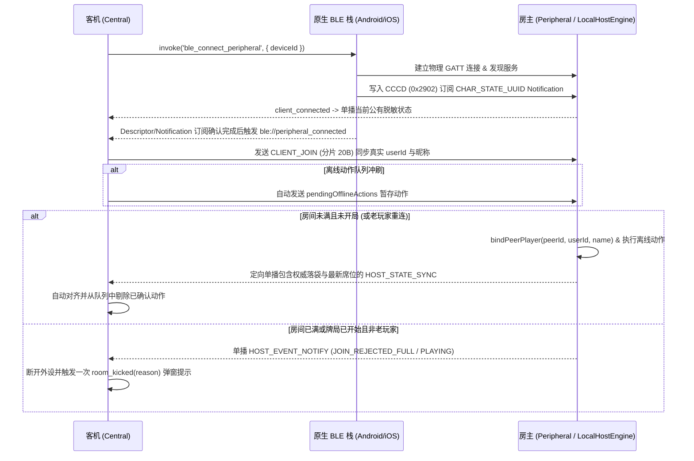

# BLE 面对面离线联机架构与协议规范 (`docs/ble_offline_architecture.md`)

本文档定义 PoolPoker（球霸扑克）**无需服务器、无需互联网连接**的蓝牙低功耗（BLE, Bluetooth Low Energy）面对面联机架构、房主权威与客机乐观更新链路、传输层模块化分工、统一传输接口、GATT 服务拓扑、二进制传输协议规范以及作为技术储备的 CRDT 确定性事件溯源模型。

---

## 1. 架构概览与设计原则

在无网络或信号不佳的线下台球房场景中，多部手机可通过 BLE 直接组建局域对局网络（1 台房主 Peripheral + 最多 7 台客机 Central）进行完整对局。

### 1.1 现实痛点与架构演进

线下打台球存在极其普遍的使用习惯：
- **交替锁屏与离线记牌**：房主建房开局后，看完自己的手牌通常会**立即锁屏将手机放入口袋**；随后其他成员轮流上台击球，某位成员亮屏记录进球/罚牌，记录完毕后也**随手锁屏入兜**。
- **传统 GATT 单主星型网络的痛点**：
  - 传统模式下房主 Peripheral 一旦锁屏休眠，GATT 链路中断，其他设备被系统阻断；
  - 若采用重型 Raft/Paxos 动态换主方案，多名成员隔绝锁屏后各自记牌，会形成互不相容的分支快照，汇合时产生严重脑裂（Split-Brain），不得不弹出糟糕的“二选一”冲突确认弹窗舍弃某一方的记录。
- **当前生产架构：房主权威状态 ＋ 客机乐观更新 ＋ 待发送队列**：
  - **房主权威单主**：房主端运行 `LocalHostEngine`，所有对局终态与洗牌发牌由房主权威决定，杜绝规则分歧；
  - **客机 0ms 乐观更新**：台球落袋操作在业务上具备天然的可叠加性，客机在断网或房主锁屏时即刻本地消牌并产生落袋动画与音效；
  - **离线队列持久化与自动冲刷**：动作推入持久化队列，待房主亮屏建立短连接后自动有序重放冲刷对齐，实现零冲突无感收敛。
- **未来去中心化储备：CRDT 纯领域事件溯源**：
  - 在 `src/services/crdt/` 中保留了完整的无主确定性事件演算模型，供后续向完全无主 Mesh 拓扑演进。

### 1.2 核心设计原则

1. **零 C/JS 外部引擎冗余，复用纯 TypeScript 权威领域模型**
   - 房主手机直接在前端运行 `LocalHostEngine`（`src/services/localHostEngine.ts`），原汁原味复用 `server/gameEngine.ts`、`server/pokerDeck.ts` 与 `server/services/gameRoomService.ts` 的全部规则（CSPRNG 发牌、8 号球规则、胜负判定、积分结算、悔球回退），并增加本地存储持久化支持。
   - 无需 QuickJS 或独立后台 HTTP Server。
2. **统一传输接口与传输层模块化分工（`GameTransport` & `src/services/ble/`）**
   - 定义项目统一的 `GameTransport` 传输接口（`src/types/transport.ts`），彻底替换此前将 BLE 强制转为 Socket 的类型断言（`ble as any as Socket`）。
   - 将原单文件膨胀的传输层拆分为 5 大高内聚低耦合模块：
     - `BleConnectionManager`：连接生命周期、Tauri 原生事件监听与断线自动重连；
     - `BleHandshakeManager`：入房握手分包、`peerId ↔ userId` 映射与退房 `LEAVE_ACK` 协商；
     - `BleCommandQueue`：离线待发动作双重持久化队列、幂等重试与权威落袋球剪枝；
     - `BleStateSync`：下行状态重组、客机 0ms 乐观更新演算与房主状态脱敏单播；
     - `BleStorage`：设备 ID、房间快照与动作队列持久化（`localStorage` + 内存降级）。
3. **客机本地乐观更新与离线队列双重持久化**
   - 客机即使处于蓝牙断开状态，打出卡牌或记球仍立即在本地生效（消除手牌、增加落袋球、触发 3D 动画与音效）；
   - 离线动作加入队列并持久化到 `localStorage` 与内存，防杀后台、防页面刷新；重连后自动冲刷并与权威状态无缝对齐。
4. **房主零拷贝直通，客机紧凑二进制定向单播**
   - **房主本人**：通过 `LocalHostEngine.getDirectClientRoom(hostUserId)` 直接获取无损脱敏 `Room` 视图（完整保留 15 条对局日志、真实卡牌 ID `c_1..c_54` 与玩家昵称），不经过二进制编解码自环。
   - **蓝牙客机**：房主为每位已连接的客机单独生成脱敏二进制状态帧（仅包含该客机自己的手牌索引，绝不泄露其他玩家未打出的底牌），并通过 GATT Notification 按 `peerId` 定向单播。

### 1.3 分层数据流拓扑

```
┌─────────────────────────────────────────────────────────────────────────┐
│ Vue 3 视图与业务层 (RoomLobby.vue / useGameRoom.ts / useNearbyRooms.ts) │
│ • Screen WakeLock 屏幕常亮保护   • 离线动作放行   • 0ms 乐观响应          │
└───────────────────┬─────────────────────────────────┬───────────────────┘
                    │ emit / on (统一 GameTransport)    │ startContinuousScan
                    ▼                                 ▼
┌───────────────────────────────────────────────────┐ ┌───────────────────┐
│ BleTransport (src/services/bleTransport.ts 门面协调)│ │ BleScanner        │
│  ├─ 连接管理: BleConnectionManager                │ └─────────┬─────────┘
│  ├─ 握手鉴权: BleHandshakeManager                 │           │
│  ├─ 指令队列: BleCommandQueue                     │           │
│  ├─ 状态同步: BleStateSync                        │           │
│  ├─ 存储持久化: BleStorage                         │           │
│  └─ 房主权威引擎: LocalHostEngine (运行于房主端)     │           │
└───────────────────┬───────────────────────────────┘           │
                    │ invoke / listen ('ble://*')               │
                    ▼                                           ▼
┌─────────────────────────────────────────────────────────────────────────┐
│ Rust Tauri 桥接层 (src-tauri/src/ble_mesh.rs)                            │
│  ├─ Android: JNI 双向桥接 (Java_com_poolpoker_app_BleMeshManager_*)     │
│  └─ iOS:     Swift C-ABI 双向桥接 (@_cdecl / @_silgen_name)             │
└───────────────────┬─────────────────────────────────┬───────────────────┘
                    │                                 │
                    ▼                                 ▼
┌───────────────────────────────────────┐ ┌───────────────────────────────┐
│ Android 原生 BLE 栈                    │ │ iOS 原生 CoreBluetooth 栈      │
│ (BleMeshManager.kt)                   │ │ (BleMeshBridge.swift)         │
│  ├─ BluetoothLeAdvertiser / GattServer│ │  ├─ CBPeripheralManager       │
│  └─ BluetoothLeScanner / BluetoothGatt│ │  └─ CBCentralManager          │
└───────────────────────────────────────┘ └───────────────────────────────┘
```

---

## 2. 【技术储备】CRDT 确定性事件溯源与无冲突收敛模型 (`src/services/crdt/`)

> [!NOTE] 架构现状与实现对齐
> 本节描述的 CRDT 去中心化事件溯源演算模型（`src/services/crdt/`）已在纯领域层实现并具备全套单元测试（`crdtEngine.spec.ts`），作为未来支持完全无主、点对点 Mesh 网络的架构储备。
> 当前生产实际运行的对局链路使用的是成熟轻量的**「房主权威状态（LocalHostEngine）＋客机乐观更新（applyLocalOptimisticAction）＋待发送离线队列（BleCommandQueue）」**（详见第 3 节）。

### 2.1 创世基线（Genesis Snapshot）与确定性 Mulberry32 PRNG

在牌局发牌瞬间（`start_game`），网络全员建立瞬时连接并确定席位，生成不可变的 `GenesisSnapshot`：

```typescript
export interface GenesisSnapshot {
  gameId: string;              // 全局唯一对局 UUID
  roomCode: string;            // 4 位房间码
  startedAt: number;           // 开局时间戳
  deckSeed: number;            // 32-bit CSPRNG 种子
  settings: {
    cardsPerPlayer: number;    // 每人发牌数
    includeBlackEight: boolean;
  };
  players: Array<{
    userId: string;
    name: string;
    seatIndex: number;
  }>;
}
```

- **确定性 Mulberry32 伪随机数发生器**：给定相同的 32 位种子 `deckSeed`，在任何设备（V8、JavaScriptCore、QuickJS）上均产生完全一致的伪随机序列，驱动 Fisher-Yates 算法洗牌，使所有设备即使在完全离线状态下也能确定性推导出初始牌堆分配。

### 2.2 离线操作事件规范（Game Events）与 Lamport 全序时钟

离线操作抽象为不可变的离线操作事件流：

```typescript
export type GameEventType =
  | 'POCKET_BALL'        // 正常进球 (消除对应手牌)
  | 'DRAW_PENALTY'       // 抽罚牌 (从确定性牌堆抓取下一张)
  | 'ACCIDENTAL_POCKET'  // 误进事故球
  | 'BREAK_POCKET'       // 开球进球
  | 'RETRACT_EVENT';     // 悔球 (撤销特定前置 eventId)

export interface GameEvent {
  eventId: string;        // UUID
  gameId: string;
  actorUserId: string;
  type: GameEventType;
  lamportTime: number;    // 逻辑时钟，用于偏序排定
  wallTime: number;       // 物理毫秒时间戳
  ballNumber?: number;    // 目标球号 (1..15)
  targetUserId?: string;  // 裁判代记目标
  retractTargetId?: string; // 悔球对应的被撤销事件 ID
}
```

- **全序比较器 (`compareGameEvents`)**：
  排序规则：`Lamport 时钟升序 -> 物理时间戳升序 -> 事件 ID 字典序`。这确保了跨设备接收到的事件流在排序后具备全局唯一全序。

### 2.3 确定性状态演算函数 (`reduceGameState`)

`reduceGameState(genesis, events, viewUserId?)` 是一个**无副作用的纯函数**：
1. **幂等去重**：以 `eventId` 为键过滤重复到达的事件包；
2. **处理撤销**：扫描所有 `RETRACT_EVENT` 并建立剔除黑名单；
3. **确定性重放**：按照全序重放有效事件流，更新已落袋球号、玩家手牌与剩余牌堆；
4. **胜负判定与脱敏裁剪**：根据当前落袋球号判定玩家是否清空有效手牌，并根据 `viewUserId` 裁剪非本人私有底牌。

### 2.4 落袋球号集合并集公理（Set Union Commutativity）

PoolPoker 判定胜负的核心是“未打出的有效卡牌数量为 0”，而有效卡牌由全局已落袋球号列表 `pocketedBallNumbers` 决定：
$$E_{\text{pocketed}} = E_{\text{accidental}} \cup E_{\text{break}} \cup \bigcup_{p \in \text{players}} E_{\text{pocketedCards}}(p)$$

由于集合并集运算满足结合律与交换律：
$$A \cup B = B \cup A$$
成员 A 在锁屏期间记录 3 号球落袋，成员 B 在锁屏期间记录 8 号球落袋，无论网络以何种顺序汇合，最终落袋球号集合恒等于 $\{3, 8\}$。数学上的可交换性彻底杜绝了并发冲突与脑裂，无需任何两难的人工仲裁。

### 2.5 犯规记牌约束公理（Foul Penalty Self-Only Invariant）

台球进球操作天然满足集合并集可交换性（$A \cup B = B \cup A$），故出牌与落袋可进行离线乐观合并；但发牌牌堆（Deck）属于有序单向消耗的栈结构（FIFO/LIFO）。
在离线或交替锁屏期间，若允许玩家相互代他人记犯规（Referee Penalty）：
- 玩家 A 离线给自己或他人记牌摸取了牌堆顶端的卡牌，随后锁屏未广播；
- 玩家 B 离线也记犯规罚牌，从各自未同步的牌堆顶端摸取了同一张卡牌；
- 汇合时将产生严重的底牌冲突与脑裂，且手牌私密性使得第三方代抽状态无法无感收敛。

**本地版约束**：在本地离线模式下，**前端仅允许给自己记牌，严禁给他人记牌**（前端交互层进行拦截收敛：UI 仅对本人开放犯规记牌入口，`RefereeFoulModal` 锁定为当前玩家本人，隐藏他人记犯规入口，避免用户跨设备给他人代记罚牌；后端与传输层保持协议通用性）。每位玩家各自对其犯规行为负责，彻底杜绝交叉代记引发的状态裂隙。

---

## 3. 客户端本地乐观更新与离线队列同步机制

### 3.1 本地乐观执行（`applyLocalOptimisticAction`）

客机用户点击手牌或点击 3D 台面球号时，`BleTransport.emit` 不再受 `this.connected` 限制：
- **0ms 本地瞬时更新**：
  1. 从自身手牌中移除对应卡牌并移入 `pocketedCards`；
  2. 将球号追加到 `cachedRoom.pocketedBallNumbers` 并排序；
  3. 检验全场各玩家手牌，若有玩家有效手牌清空则判定获胜（`status = 'finished'`）；
  4. 构造 `sceneEvent` 驱动 Three.js 台球滚入球袋动画与落袋音效；
  5. 强制触发 `room_updated`，页面 UI 即刻响应，消除网络等待感。

### 3.2 离线动作双重持久化队列（`pendingOfflineActions`）

- 客机产生的每一个本地动作，立即加入 `pendingOfflineActions` 数组；
- 双重持久化策略：同时写入 JS 内存与 `localStorage`（键名格式 `poolpoker_ble_{roomCode}_pending_actions`）；
- 无论手机因低电量自动关机、应用被系统后台查杀还是切出重载，已记动作绝对不丢失。

### 3.3 物理链路恢复自动冲刷（`flushPendingOfflineActions`）

当房主手机点亮屏幕或走入连接范围，底层触发 `ble://peripheral_connected` 原生事件：
1. 客机自动调用 `sendJoinHandshake()` 恢复身份席位；
2. 自动触发 `flushPendingOfflineActions()`，从持久化存储提取未确认动作，按 60ms 间隔串行向房主写入特征值；
3. 房主端本地权威引擎 `executeBinaryAction` 执行动作并向全场广播权威状态；
4. 客机在接收到权威状态（`HOST_STATE_SYNC`）后，比对落袋球号集合，自动剪除已被权威状态覆盖的暂存动作，并重新落盘。

### 3.4 房主离线锁屏下的 Rejoin 状态保护

客机锁屏后再解锁重新进入页面时，触发 `useGameRoom.ts` 的 `rejoin_room`：
- 若此时房主仍处于锁屏离线状态，底层的 `ble_connect_peripheral` 物理建连必然失败；
- **会话保护机制**：
  - `BleTransport` 自动从 `localStorage` 加载 `cachedRoom` 恢复游戏界面；
  - 返回 `{ success: true, roomCode, sessionToken }`，界面提示友好文案 **“房主锁屏离线中，已开启离线记牌（随时打出，碰面自动对齐）”**；
  - 严禁执行 `localStorage.removeItem('billiards_room_code')`，绝不把玩家踢出对局；
  - 启动指数退避自动重连调度（1s, 2s, 3s, 5s...），静默等待房主亮屏。

### 3.5 Web Screen WakeLock 屏幕常亮与切回前台唤醒恢复

- 在 `useGameRoom.ts` 接入 Web Screen WakeLock API；
- 对局进行期间（`status === 'playing'`）自动申请屏幕常亮锁定，显著降低对局中因超时自动熄屏的频率；
- 监听 `document.visibilitychange`：用户手动亮屏或应用切回前台时，自动重新申请常亮锁定。

---

## 4. GATT 服务与广播规范

### 4.1 GATT UUID 定义

| 角色 / 用途 | 名称 | 128-bit UUID | 属性与权限 |
| :--- | :--- | :--- | :--- |
| 主服务 | `SERVICE_UUID` | `0000a848-0000-1000-8000-00805f9b34fb` | Primary Service |
| 上行指令特征值 (客机 → 房主) | `CHAR_COMMAND_UUID` | `0000a849-0000-1000-8000-00805f9b34fb` | `Write`, `WriteWithoutResponse` |
| 下行状态特征值 (房主 → 客机) | `CHAR_STATE_UUID` | `0000a84a-0000-1000-8000-00805f9b34fb` | `Notify`, `Read` (含 CCCD `0x2902`) |

### 4.2 跨平台广播载荷与解析兼容

受限于传统 BLE 广播包（Legacy Advertising PDU）31 字节上限及 iOS `CBPeripheralManager` 仅允许广播 `ServiceUUIDs` 与 `LocalName` 的系统限制，双端采用互补编码并在扫描端双向兼容解析：

- **Android 房主广播（`BleMeshManager.kt`）**：
  - 主广播包（Advertising Data）：包含 128-bit `SERVICE_UUID`。
  - 扫描响应包（Scan Response）：携带 `ServiceData(SERVICE_UUID)`，内容为 UTF-8 字符串 `"<roomCode>|<shortHostName>"`（其中 `shortHostName` 经 `truncateUtf8` 截断至最多 8 字节，确保不越界）。
- **iOS 房主广播（`BleMeshBridge.swift`）**：
  - 广播 `CBAdvertisementDataServiceUUIDsKey: [POOLPOKER_SERVICE_UUID]`。
  - 广播 `CBAdvertisementDataLocalNameKey: "PoolPoker_<roomCode>_<shortHostName>"`（`shortHostName` 最多 8 字节 UTF-8）。
- **扫描端统一解码与过期淘汰**：
  - Android `ScanCallback` 与 iOS `didDiscover` 均优先解析 `ServiceData`（按 `|` 分割房间号与房主昵称），若无则回退解析 `LocalName`（识别 `PoolPoker_` 前缀并按 `_` 分割）。
  - iOS 开启 `CBCentralManagerScanOptionAllowDuplicatesKey: true` 并按外设 UUID 执行 1.5s 节流上报，确保距离/信号强度（RSSI）实时刷新，同时配合前端 `BleScanner` 的 **12 秒 TTL 过期清理定时器**自动剔除已关闭的房间。

---

## 5. 二进制协议规范 (`shared/types/bleProtocol.ts` 与 `shared/utils/bleCodec.ts`)

协议版本号：`BLE_PROTOCOL_VERSION = 0x01`。所有多字节整数采用大端序（Big-Endian）。

### 5.1 卡牌与台球编码映射

- **扑克牌索引（`0..53`，1 Byte）**：
  - `0..51`：`index = suitIndex * 13 + (ballNumber - 1)`，花色顺序：`0: ♠ (spade)`, `1: ♥ (heart)`, `2: ♣ (club)`, `3: ♦ (diamond)`；点数 `1..13` 对应 `A..K`。
  - `52`：小王（`JOKER-S`，对应 14 号球，`color: 'gray'`）。
  - `53`：大王（`JOKER-B`，对应 15 号球，`suit: '👑'`, `color: 'gold'`）。
  - 默认解码生成的卡牌 ID 为 `c_1..c_54`，与服务端 `create54PokerDeck()` 完全对齐。
- **台球落袋位掩码（`pocketedBallsMask`，2 Bytes `uint16`）**：
  - Bit `1..15` 分别对应 1~15 号球是否已落袋（`mask & (1 << ballNumber)`）。

### 5.2 消息类型（`BleMessageType`）

| 枚举名 | 十六进制值 | 方向 | 说明 |
| :--- | :--- | :--- | :--- |
| `HOST_STATE_SYNC` | `0x10` | 房主 → 客机 | 完整单帧房间状态同步 |
| `CLIENT_COMMAND` | `0x11` | 客机 → 房主 | 客机游戏操作指令（8 字节定长） |
| `HOST_STATE_CHUNK` | `0x12` | 房主 → 客机 | 下行状态分片包（超 MTU 时自动切片） |
| `CLIENT_JOIN` | `0x13` | 客机 → 房主 | 客机入房/重连身份握手帧（携带真实 `userId` 与昵称） |
| `HOST_EVENT_NOTIFY` | `0x14` | 房主 → 客机 | 房主控制事件帧（踢人、满员/开局拒连、退房确认 `LEAVE_ACK`） |
| `CLIENT_COMMAND_CHUNK` | `0x15` | 客机 → 房主 | 上行指令/握手分片包（兼容最小 ATT MTU 23） |

### 5.3 帧结构定义

#### (1) 下行房间状态帧 (`HOST_STATE_SYNC = 0x10`)

- **定长头部（11 Bytes）**：
  - `Byte 0`: `version` (`0x01`)
  - `Byte 1`: `msgType` (`0x10`)
  - `Byte 2..3`: `revision` (`uint16`)
  - `Byte 4`: `status & cardsPerPlayer`（高 4 位：`0=WAITING, 1=PLAYING, 2=FINISHED`；低 4 位：`cardsPerPlayer`）
  - `Byte 5..6`: `pocketedBallsMask` (`uint16`)
  - `Byte 7`: `roundCount` (`uint8`)
  - `Byte 8`: `deckRemaining` (`uint8`)
  - `Byte 9`: `selfAndHostIndex`（高 4 位 `hostSeatIndex`，低 4 位 `selfSeatIndex`，未分配为 `0x0F`）
  - `Byte 10`: `selfHandCount` (`uint8`)
- **接收方私有手牌区（`selfHandCount` Bytes）**：每个字节为一个卡牌索引 `0..53`。
- **玩家席位列表**：
  - `Byte P0`: `playerCount` (`0..8`)
  - 每个玩家席位基础记录（7 Bytes）：
    - `userIdHash` (`uint32`, FNV-1a 32-bit 哈希)
    - `flagsAndCards` (`uint8`：Bit7 `isHost`, Bit6 `online`, Bit5 `isWinner`, 低 5 位 `cardCount`)
    - `totalScore` (`int16` 补码)
- **尾部扩展区（Magic `0xA5`）**：
  - `extFlags` (`uint8`)：
    - `Bit 0 (0x01)`: 包含 `turnOrderSeats`（`1B length + N Bytes seatIndex`）
    - `Bit 1 (0x02)`: 包含 `sceneEvent`（`1B kind + 1B ballNumber + 2B revision`）
    - `Bit 2 (0x04)`: 包含 `lastActionText`（`1B byteLen + UTF-8 bytes`，强制通过 `truncateUtf8Bytes` 限制在 **180 字节**以内，严防溢出）
    - `Bit 3 (0x08)`: 包含每位玩家的扩展详情（`1B nameLen + UTF-8 name [上限 48 字节] + 1B wins + 1B pocketedCount + pocketedIndices + 1B revealedCount + revealedIndices`）

#### (2) 上行客机指令帧 (`CLIENT_COMMAND = 0x11`，定长 8 Bytes)

- `Byte 0`: `version` (`0x01`)
- `Byte 1`: `msgType` (`0x11`)
- `Byte 2`: `revision` (`uint8`)
- `Byte 3`: `actionType` (`1=START_GAME, 2=POCKET_BALL, 3=DRAW_PENALTY, 4=ACCIDENTAL_POCKET, 5=BREAK_POCKET, 6=RETRACT_BALL, 7=RESTART_GAME, 8=REFEREE_POCKET, 9=REFEREE_PENALTY, 10=UPDATE_SETTINGS, 11=KICK_PLAYER, 12=LEAVE_ROOM`)
- `Byte 4`: `ballNumber` (`uint8`)
- `Byte 5`: `cardIndex` (`uint8`, 无则为 `0xFF`)
- `Byte 6`: `cardsPerPlayer` (`uint8`)
- `Byte 7`: `targetSeatIndex` (`uint8`, 无则为 `0xFF`)

#### (3) 上行入房握手帧 (`CLIENT_JOIN = 0x13`)

- `[0x01, 0x13, revision(2B), roomCode(2B), userIdLen(1B), ...userIdBytes, nameLen(1B), ...nameBytes]`

#### (4) 下行控制事件帧 (`HOST_EVENT_NOTIFY = 0x14`，定长 5 Bytes)

- `[0x01, 0x14, code(1B), roomCodeHigh(1B), roomCodeLow(1B)]`
- `code`: `1 = KICKED`, `2 = JOIN_REJECTED_FULL`, `3 = JOIN_REJECTED_PLAYING`, `4 = LEAVE_ACK`。

#### (5) 分片与重组帧 (`HOST_STATE_CHUNK = 0x12` / `CLIENT_COMMAND_CHUNK = 0x15`)

- **5 字节分片头**：`[0x01, chunkMsgType(1B), transferId(1B), chunkIndex(1B), totalChunks(1B), ...sliceBytes]`
- **动态 MTU 适配**：
  - 下行方向：Android 根据每个 `BluetoothDevice` 协商的 `clientMtuMap`（默认回退 23 字节即 20 字节载荷），iOS 根据 `CBCentral.maximumUpdateValueLength` 动态计算单包切片上限。
  - 上行方向：`CLIENT_JOIN` 握手默认按 20 字节安全上限切分为 `CLIENT_COMMAND_CHUNK`，兼容尚未完成大 MTU 协商的初期连接。
  - 重组器 `BleChunkReassembler` 按 `transferId` 校验分片连续性，收到新 `transferId` 时自动丢弃旧批次残片。

---

## 6. 连接、握手、重连与退房状态机



### 关键时序不变量

1. **先完成订阅，再触发 `peripheral_connected` 发送握手与冲刷队列**：
   - Android 必须在 `BluetoothGattCallback.onDescriptorWrite`（CCCD 写入完成）之后、iOS 必须在 `peripheral(_:didUpdateNotificationStateFor:error:)`（Notification 订阅生效）之后，才向前端发射 `ble://peripheral_connected` 并开启上行发送与离线冲刷队列。
2. **上行无响应写入（`writeWithoutResponse`）流控**：
   - Android 通过 `isClientWriteInFlight` + `onCharacteristicWrite` 串行化写入队列。
   - iOS 通过 `CBPeripheral.canSendWriteWithoutResponse` 与 `peripheralIsReady(toSendWriteWithoutResponse:)` 回调控制出队，防止长昵称多片 `CLIENT_JOIN` 报文被 CoreBluetooth 静默丢弃。
3. **满员房间老玩家 MAC 轮换重连保护**：
   - 当客机因系统蓝牙隐私策略轮换物理地址（`peerId`）重连时，房主在 `ble://client_connected` 阶段**绝不**按临时 `peerId` 提前拒连，而是等待 `CLIENT_JOIN` 报文揭晓真实 `userId` 后，在 `bindPeerPlayer` 中匹配既有席位并无损恢复在线状态与手牌。
4. **主动退房 `LEAVE_ACK` 确认握手机制**：
   - 客机点击退出房间时，先发送 `LEAVE_ROOM` 指令并等待房主返回 `HOST_EVENT_NOTIFY(LEAVE_ACK)`（1.5 秒超时兜底），确认房主已释放席位并清空本地缓存后再调用 `ble_disconnect_peripheral` 断开物理连接。

---

## 7. 平台权限与配置要求

- **Android (`android/app/src/main/AndroidManifest.xml`)**：
  - Android 12+ (API 31+)：`BLUETOOTH_SCAN`（`neverForLocation`）、`BLUETOOTH_ADVERTISE`、`BLUETOOTH_CONNECT`。
  - Android 11 及以下：`BLUETOOTH`、`BLUETOOTH_ADMIN`、`ACCESS_FINE_LOCATION`。
- **iOS (`apple/poolpoker_iOS/Info.plist`)**：
  - `NSBluetoothAlwaysUsageDescription`：声明使用蓝牙在附近建立面对面台球扑克房间。
- **模式切换隔离 (`src/composables/useSocket.ts` & `useGameRoom.ts`)**：
  - 切换在线/离线模式（`toggleBleOfflineMode`）时自动清理 `billiards_room_code`、`billiards_session_token` 与 `poolpoker_ble_device_id`，并在离线模式下跳过远端 HTTP `/api/rooms/:code` 快照拉取与手表在线凭证同步。
